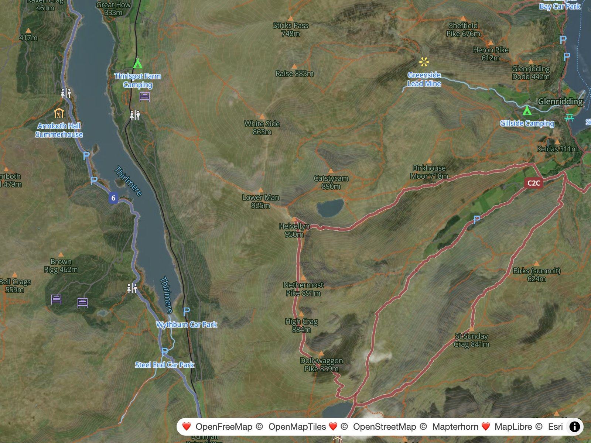
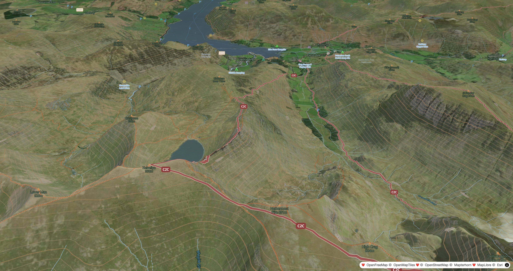
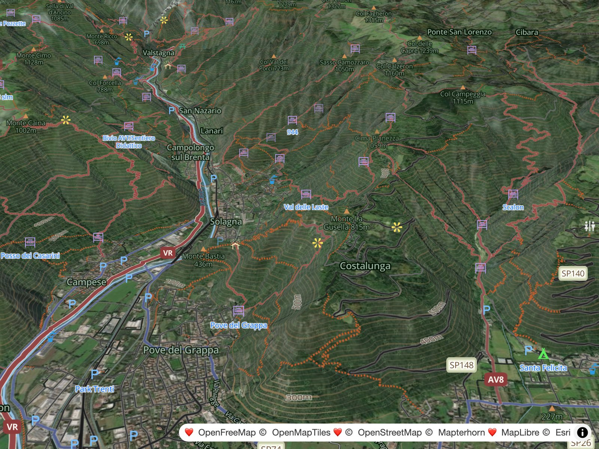
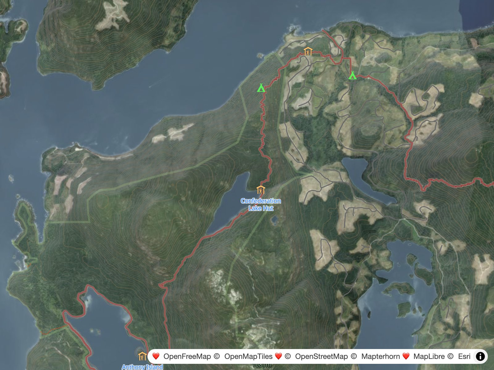
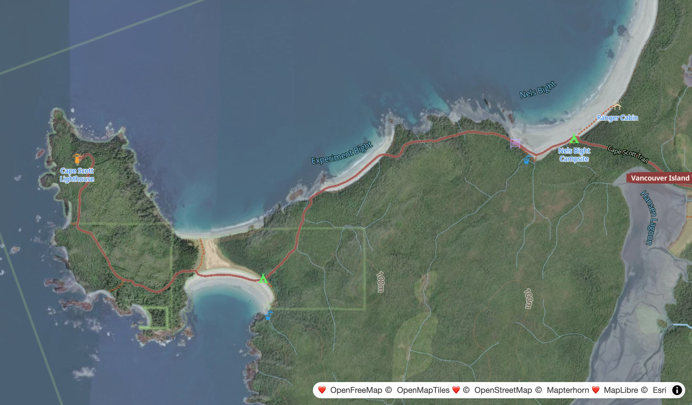
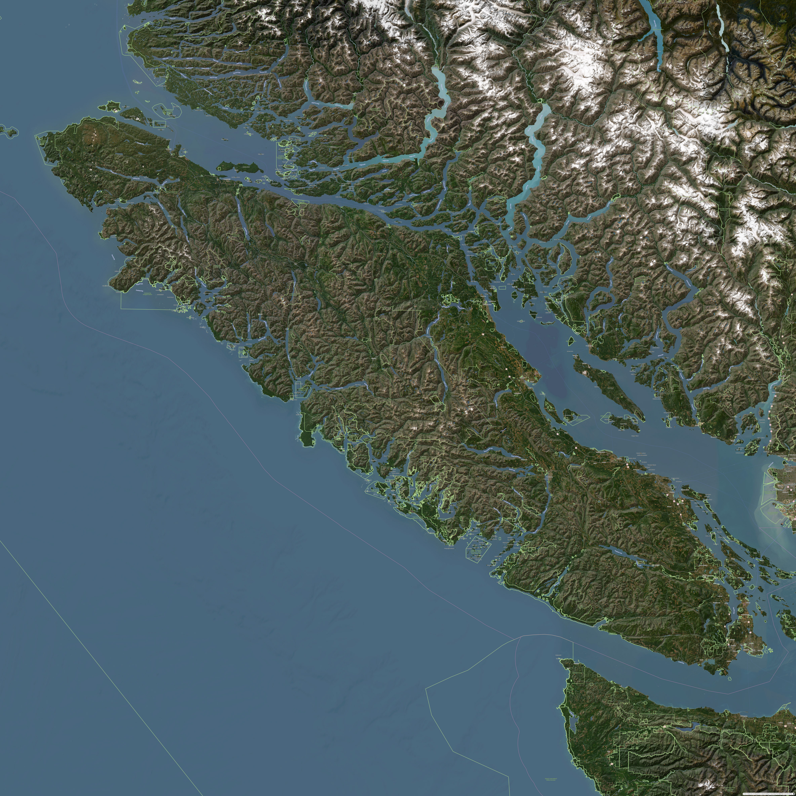
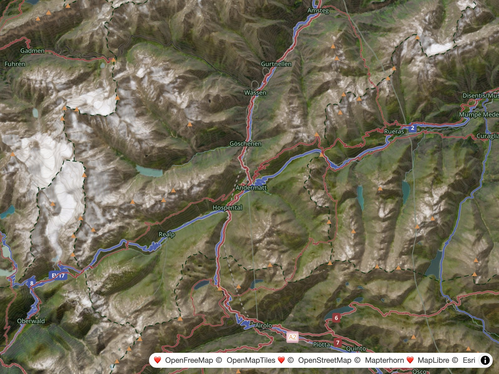
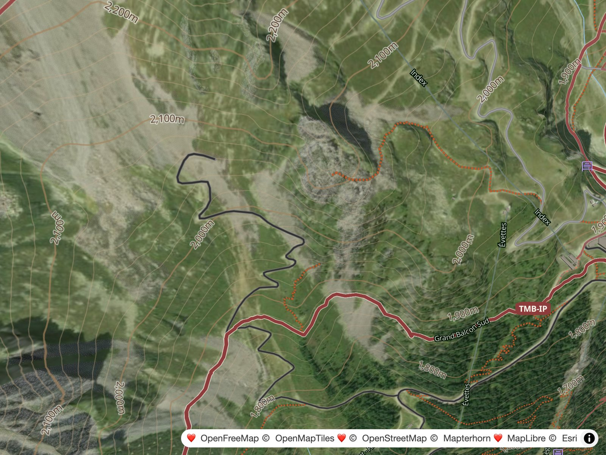
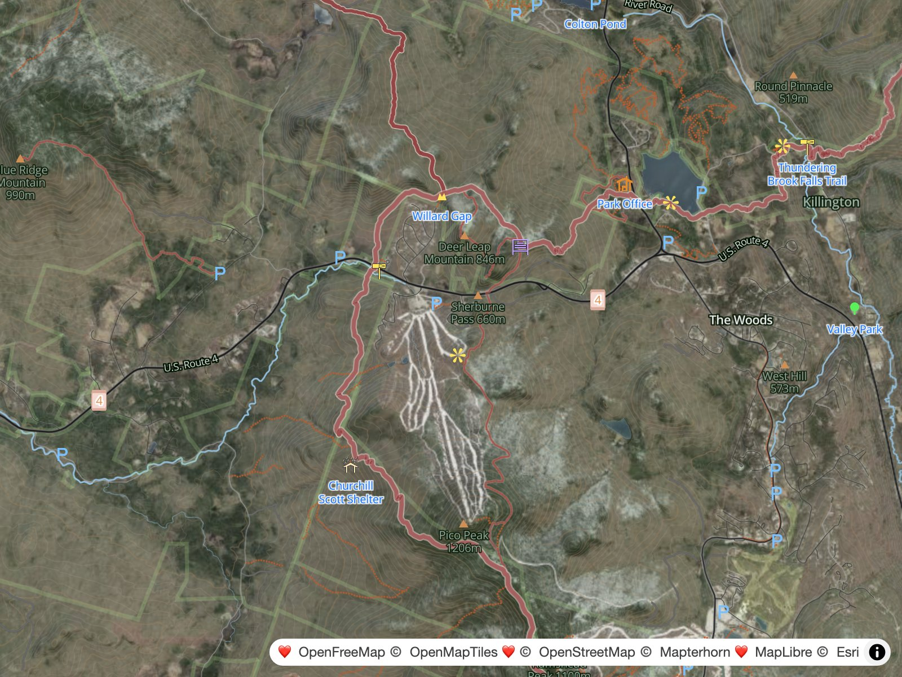

# Outdoors

> A Free and Open-Source 3D rendering of your surroundings.

🌎🌍🌏 **[[DEMO]](https://www.ogis.app/)** 🌎🌍🌏

> [!WARNING]
> This project is a **work in progress**, expect changes!

---

## Screenshots

[](https://www.ogis.org/outdoors/#12/54.52653/-3.01724)
[](https://www.ogis.org/outdoors/#15/54.525076/-3.001451/60/47)
[](https://www.ogis.org/outdoors/#13.03/45.81048/11.73434/-27.6/60)
[](https://www.ogis.org/outdoors/#12/49.97661/-124.45956)
[](https://www.ogis.org/outdoors/#12.93/50.77868/-128.39204)
[](https://www.ogis.org/outdoors/#6.82/49.617/-126.76)
[](https://www.ogis.org/outdoors/#10/46.6344/8.5931)
[](https://www.ogis.org/outdoors/#15/45.9607/6.8773)
[](https://www.ogis.org/outdoors/#12/43.65876/-72.83825)

---

## Dependencies

### Sources

- [© OpenStreetMap Contributors](https://www.openstreetmap.org/copyright)
- [OpenFreeMap](https://openfreemap.org/) — OSM vector tiles of the entire planet.
- [© Mapterhorn](https://mapterhorn.com/) — DEM source for 3D terrain and hillshading.
- [© Esri World Imagery](https://server.arcgisonline.com/ArcGIS/rest/services/World_Imagery/MapServer) — Satellite ground raster blended over the natural-earth vectors (used when the `SATELLITE_GROUND` feature is enabled).
- [Open GIS Tile Server](https://tile.ogis.app/) — core outdoor data dependency: the outdoor POI, waymarked-route, low-zoom path and contour vector tiles that the style layers over the basemap. Its source code and operations documentation live in the public [OpenGIS/tiles](https://github.com/OpenGIS/tiles) repository, and the live [source inventory](https://tile.ogis.app/sources) publishes each source's name, zoom range, build id and TileJSON link.
  - [Style Assets](https://www.ogis.org/basemap/) - Basemap style glyphs & sprites.

### Core

- [OpenMapTiles](https://github.com/openmaptiles/openmaptiles)
  - [Schema](https://openmaptiles.org/schema)
  - [OSM Style](https://github.com/openmaptiles/openmaptiles/tree/master/style)
- [MapLibre Style Spec](https://maplibre.org/maplibre-style-spec/)

## Run

Node.js 22 or newer is required.

### Build

```bash
npm install                           # Install dependencies
npm run build                         # Build `style.json` from `scripts/build.mjs` (also validates)
```

Map and icon colours live in [`palette.json`](palette.json), which also registers the icon set. After editing the palette or the authored icon sources in `icons/`, regenerate the derived files in order: `npm run palette:build` (optional; `npm run sprite:build` renders first) → `npm run sprite:build` → `npm run build` → `npm run demo:build`. `npm run sprite:build` also rewrites the committed `sprite.lock.json`, which records sha256 digests of the sources and sheets so CI can verify sprite freshness without `spreet`. `style.json`, the sprite sheets in `dev/public/` and the lock are committed; the rendered icons in `build/icons/` and the app bundle in `dist/` are generated.

### Other

```bash
# Validate
npm run validate:style                # Validate `style.json` (MapLibre style spec)

# Palette & sprites
npm run palette:build                 # Render `icons/` through `palette.json` into gitignored `build/icons/`
npm run palette:check                 # Validate `palette.json` + `icons/` and verify `sprite.lock.json` (no render)
npm run sprite:build                  # Render icons, build the sprite sheets and rewrite `sprite.lock.json`

# POIs
npm run check:pois                    # Sprite icons, orphan icons, token templates, kind coverage and sort priorities

# Demo
npm run demo:build                    # Build the compare app to `dist/`
npm run demo:preview                  # Preview the `dist/` build

# Screenshots
npx playwright install chromium
npm run screenshots                   # Regenerate every shot in shots.json
npm run screenshots -- --name <id>    # Regenerate a single shot by id
npm run screenshots:check             # Check shots, JPEGs and docs references
npm run screenshots:check -- --stale  # Also fail on images older than their inputs

# Benchmark
npm run bench                         # Draw-performance benchmark of the compare app
npm run bench -- --shot bolzano-3d --variants full   # Focus a shot / variant
npm run bench -- --mode load --serve demo            # Load-benchmark the `dist/` build
```

Screenshot runs exit non-zero on a capture failure, including a filtered `--name` run.

### Development

Compare app with HMR support.

```bash
npm install                           # Install dependencies
npm run dev                           # Start Vite dev server + auto-build watcher
```

## CI & releases

- **Deploy** — [`.github/workflows/deploy.yml`](.github/workflows/deploy.yml) runs on pushes to `master`: it installs dependencies, rebuilds the style and app, and fails if `style.json` differs from the committed output (the app bundle in `dist/` is generated, not committed). It then validates the style, runs `npm run palette:check` (which verifies the committed `sprite.lock.json` because CI has no `spreet`), checks POI coverage and screenshots, and uploads the generated `dist/` build to GitHub Pages.
- **Release** — [`.github/workflows/release.yml`](.github/workflows/release.yml) runs when `package.json` changes on `master`, or on manual dispatch. If the matching `v<version>` release does not exist, it runs the same build and checks (including the `style.json` freshness check and the sprite lock) and creates the GitHub Release and tag with generated notes; if the release already exists it skips, so reruns are safe.

---

[Read the Docs →](docs/README.md)
