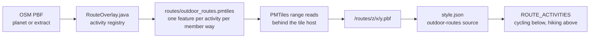

# Outdoor Routes Tile Archive

> Operator handover for the multi-activity `outdoor_routes` extract: building it from OpenStreetMap with the Planetiler profile in this repository, serving it at `/routes/{z}/{x}/{y}.pbf`, and verifying it against the shipped style.

## 1. Purpose and audience

The archive is a single PMTiles file of line vector tiles carrying the member ways of OSM hiking and cycling route relations. Activities are peers: a way that belongs to a hiking relation and a cycling relation is emitted once per activity, and every feature carries the full activity set for the relation that produced it. The archive is built by [`docs/examples/RouteOverlay.java`](docs/examples/RouteOverlay.java) and consumed by the `outdoor-routes` source in `style.json`, where each activity is drawn as a width-tiered line family with `ref`/`name` badges. A way shared by both enabled activities is owned by the higher activity and painted mixed green.



This document is for whoever runs the rebuild, whoever operates the tile host, and whoever changes the style's route layers. It assumes access to a recent Planetiler release, the OSM input, and the host that serves the archive.

The pipeline must produce:

- one PMTiles archive containing one vector layer, `outdoor_routes`;
- line features for every member way of every selected route relation, one feature per member way per surviving activity;
- `activity` and `activities` on every feature, `network` when the relation carries one in the activity's vocabulary, plus the relation's informational attributes;
- merged linework per tile using the fixed merge parameters;
- real tiles across z8–14;
- OpenStreetMap attribution in the archive metadata.

Style-side rendering rules are documented in [Activities](docs/8.activities.md). The other hosted overlays are covered in [Tile Server](docs/7.server.md); the build pipeline in [Build Script](docs/1.build.md) and [Style Structure](docs/2.style.md); vocabulary in [Terminology](docs/0.terminology.md); and rendering cost in [Performance](docs/9.performance.md).

## 2. Contract at a glance

| Property     | Value                                                                                                                                                                              |
| ------------ | ---------------------------------------------------------------------------------------------------------------------------------------------------------------------------------- |
| Source id    | `outdoor-routes` (hyphen) — the key in `style.sources` and the `source` on every route layer                                                                                       |
| Source-layer | `outdoor_routes` (underscore) — the layer name inside the tile                                                                                                                     |
| Tile URL     | `https://tile.ogis.app/routes/{z}/{x}/{y}.pbf`                                                                                                                                     |
| Format       | Mapbox Vector Tile (protobuf), one layer                                                                                                                                           |
| Geometry     | line (MVT geometry type 2)                                                                                                                                                         |
| Zoom         | source declared `minzoom: 8`, `maxzoom: 14`; the profile emits z8–14 inclusive                                                                                                     |
| Archive      | one PMTiles archive, built to `routes/outdoor_routes.pmtiles`                                                                                                                      |
| Attribution  | `© OpenStreetMap contributors` — written into the archive metadata by the profile's `attribution()`; the style does not read it (its credit comes from `metadata.attributionLine`) |

> [!WARNING]
> The source id and the source-layer differ by one character: `outdoor-routes` versus `outdoor_routes`. A layer that points at the wrong one renders nothing, and the style specification does not reject it. The URL directory is `routes` — neither `route` nor `outdoor-routes`.

The style's source URL is the `ROUTE_OVERLAY.tileUrl` constant in [`scripts/build.mjs`](scripts/build.mjs). Serving the archive elsewhere only reaches the style if that constant is changed and `style.json` is rebuilt in the same release.

### Feature identity

Before per-tile merging, the unit of emission is **one feature per member way per activity per matched relation**:

- A relation tagged for both activities emits one feature per activity for each member way. Both features carry the same `activities` set; their `activity` values differ.
- A way that belongs to two separate relations emits one feature per relation per activity. Features with different attributes do not merge with each other.
- A dual-activity relation's two features can differ in `network`, because network normalisation is per activity.
- After merging, contiguous member ways with identical attributes combine into longer lines per tile. A merged MVT feature can contain several line parts, so tile feature counts are not way counts.

`activities` is relation-scoped. It lists the activities the relation survived under, not a union across every relation that touches the way. A way in two relations produces one feature per relation, each carrying its own relation's set.

## 3. Feature schema

Every attribute is a string. The profile copies relation tags onto each member-way feature; Planetiler drops null attributes, so an absent key means the relation did not carry that tag. Treat an empty string as absent. All keys are lower-case snake_case; the OSM key `osmc:symbol` becomes `osmc_symbol`.

| Attribute     | Type   | Presence                      | Meaning                                                                                                        | Permitted values / notes                                                            |
| ------------- | ------ | ----------------------------- | -------------------------------------------------------------------------------------------------------------- | ----------------------------------------------------------------------------------- |
| `activity`    | string | required in the current model | The activity this feature was emitted for.                                                                     | `hiking` or `cycling` (the extract's activity registry is the source of truth)      |
| `activities`  | string | required in the current model | The full activity set for the relation that produced the feature, semicolon-separated, priority highest first. | `hiking`, `cycling`, `hiking;cycling`                                               |
| `network`     | string | optional                      | The relation's network in this activity's own vocabulary. Absent means unmarked.                               | hiking: `iwn`, `nwn`, `rwn`, `lwn`; cycling: `icn`, `ncn`, `rcn`, `lcn`             |
| `name`        | string | optional                      | Relation name.                                                                                                 | free text; badge fallback                                                           |
| `ref`         | string | optional                      | Relation reference.                                                                                            | free text; preferred badge text                                                     |
| `osmc_symbol` | string | optional                      | Raw `osmc:symbol` value.                                                                                       | informational, unstyled                                                             |
| `operator`    | string | optional                      | Raw operator.                                                                                                  | informational, unstyled                                                             |
| `distance`    | string | optional                      | Raw OSM value; not parsed.                                                                                     | informational, unstyled                                                             |
| `ascent`      | string | optional                      | Raw OSM value in metres; not parsed.                                                                           | informational, unstyled                                                             |
| `descent`     | string | optional                      | Raw OSM value in metres; not parsed.                                                                           | informational, unstyled                                                             |
| `cai_scale`   | string | optional                      | Raw CAI hiking scale.                                                                                          | informational, unstyled                                                             |
| `roundtrip`   | string | optional                      | Raw OSM value, normally `yes` or `no`.                                                                         | informational, unstyled                                                             |
| `route_type`  | string | legacy archives only          | The old family marker. The current profile does not emit it.                                                   | `hiking` or `bicycle`; see the [legacy appendix](#12-legacy-compatibility-appendix) |

### `activity` versus `activities`

- `activity` is the feature's own activity. It selects the style activity's tier family: a `hiking` feature is only eligible for the hiking layers, a `cycling` feature only for the cycling layers.
- `activities` is the full set for the relation, ordered highest priority first. It is a set for styling purposes; the order exists for readability and determinism, not for rendering. A dual relation emits `hiking;cycling` on both of its features.
- The style uses `activities` for ownership: a way whose `activities` contains a higher enabled activity is excluded from the lower activity's layers and painted mixed green by the higher one. `activity` alone cannot express shared membership.
- `activities` must contain `activity`. A mismatch is a broken archive; see [Troubleshooting](#10-troubleshooting).

### Network vocabulary

`network` is normalised per activity at extract time. The raw relation value is kept only when it belongs to that activity's vocabulary; otherwise the attribute is absent. Marked tiers filter on `network`; the unmarked tier matches a feature whose `network` is absent or outside its activity's marked set.

| Activity | Marked networks            | Unmarked         |
| -------- | -------------------------- | ---------------- |
| Hiking   | `iwn`, `nwn`, `rwn`, `lwn` | absent `network` |
| Cycling  | `icn`, `ncn`, `rcn`, `lcn` | absent `network` |

The vocabularies are disjoint. A dual relation with a hiking network value therefore produces a marked hiking feature and an unmarked cycling feature, both carrying the same `activities` set.

> [!NOTE]
> `network` is read whole, not split on semicolons. `network=iwn;nwn` matches neither value and becomes absent. Only the `route` tag is semicolon-split.

### Informational attributes

`osmc_symbol`, `operator`, `distance`, `ascent`, `descent`, `cai_scale` and `roundtrip` are carried so a future style can use them without rebuilding the archive. They are not read by the current layers. `name` and `ref` are also carried, but they drive badge text.

### Geometry and zoom

- One line per member way per activity before merging.
- `postProcessLayerFeatures()` calls `FeatureMerge.mergeLineStrings(items, 0.5, 0.1, 4)` on `outdoor_routes`: 0.5 px minimum length after merging, 0.1 simplification tolerance, 4 px detail outside the tile boundary.
- `setMinPixelSize(0)` disables the default drop of sub-pixel features so short member ways survive to the merge step.
- Every feature gets `setZoomRange(8, 14)`. Planetiler's feature range is inclusive at the top; the style's source `maxzoom` of 14 is the last zoom with real tiles, and MapLibre overzooms that zoom at z15 and above. The style's width and text interpolations run to z16, so z15–16 rendering depends on the z14 tile being present.
- Individual tiers have their own `minzoom`: unmarked and local from z12, regional from z9, national and international from z8. A z8 tile carrying only national and international lines, or no lines at all, is correct.

## 4. Activity model

### Two registries, two orders

The extract and the style each keep an activity registry, and their orders answer different questions. Do not copy one order into the other.

| Registry              | Location                          | Order                         | Purpose                                                                                     |
| --------------------- | --------------------------------- | ----------------------------- | ------------------------------------------------------------------------------------------- |
| `ACTIVITIES`          | `docs/examples/RouteOverlay.java` | priority, highest first       | Matches `route` tokens, applies per-activity exclusions, and builds the `activities` string |
| `ROUTE_ACTIVITIES`    | `scripts/build.mjs`               | draw order, bottom to top     | Builds layer blocks, decides draw order, and selects the owning activity for shared ways    |
| `HIKING_ROUTE_TIERS`  | `scripts/build.mjs`               | draw order, lowest to highest | Tier stacking within the hiking family                                                      |
| `CYCLING_ROUTE_TIERS` | `scripts/build.mjs`               | draw order, lowest to highest | Tier stacking within the cycling family                                                     |

- **Extract priority:** `hiking` then `cycling`. The first entry is the highest priority. It determines the order of the `activities` string (`hiking;cycling`). A relation produces exactly one `RouteRelationInfo` carrying the full survivor set, so a dual relation contributes one record whose `activities` value is `hiking;cycling`.
- **Style draw order:** `cycling` then `hiking`, bottom to top. Hiking draws on top. Later entries in `ROUTE_ACTIVITIES` are higher for ownership, so a way shared by both enabled activities is owned by hiking and painted mixed green.
- **Tier draw order:** unmarked first, then local, regional, national, international. A segment shared by several networks renders at the highest network's width because the higher tier draws later.

### Style layers and tiers

`registerRouteSource()` registers the shared source once, idempotently, with `type: "vector"`, the tile URL, `minzoom: 8` and `maxzoom: 14`. `buildRouteActivityLayers()` then emits each activity's casing, fill and badge layers. Layer ids are derived from the source id, activity id and tier:

- lines: `outdoor-routes-<activity>-<tier>` and `outdoor-routes-<activity>-<tier>-casing`
- badges: `outdoor-routes-<activity>-badges-<major|local>`

Each activity has five tiers in draw order:

| Rank          | Hiking id  | Cycling id | Network | From | Linework                           |
| ------------- | ---------- | ---------- | ------- | ---- | ---------------------------------- |
| Unmarked      | `unmarked` | `unmarked` | —       | z12  | Dashed neutral grey, softer casing |
| Local         | `lwn`      | `lcn`      | lwn/lcn | z12  | Solid, activity colour             |
| Regional      | `rwn`      | `rcn`      | rwn/rcn | z9   | Solid, activity colour             |
| National      | `nwn`      | `ncn`      | nwn/ncn | z8   | Solid, activity colour             |
| International | `iwn`      | `icn`      | iwn/icn | z8   | Solid, activity colour             |

The width ladder is shared by rank, not by activity, so the two families have the same hierarchy. Casing width is 1.35× the fill width at the same zoom stops. Marked lines are solid; the unmarked line is dashed `[4, 2]` with a butt cap. Fill and casing alphas compound where they overlap:

| Rank                    | Fill alpha | Casing alpha |
| ----------------------- | ---------- | ------------ |
| Unmarked                | 0.5        | 0.25         |
| Local, regional         | 0.65       | 0.3          |
| National, international | 0.57       | 0.4          |

| Rank          | Width stops (px)                               |
| ------------- | ---------------------------------------------- |
| Unmarked      | z12 1.6 → z14 2.0 → z16 2.6                    |
| Local         | z12 1.8 → z14 2.6 → z16 3.6                    |
| Regional      | z9 1.6 → z11 2.4 → z13 3.4 → z15 4.8 → z16 5.2 |
| National      | z8 1.6 → z10 2.5 → z12 3.5 → z14 5 → z16 6.6   |
| International | z8 2 → z10 3.2 → z12 4.4 → z14 6.6 → z16 8.8   |

Colours and badge icons:

| Token / icon                    | Value                  | Used by                        |
| ------------------------------- | ---------------------- | ------------------------------ |
| `COLOURS.ROUTES.HIKING`         | `#8e3b3b` (oxblood)    | hiking marked fills            |
| `COLOURS.ROUTES.CYCLING`        | `#46589f` (indigo)     | cycling marked fills           |
| `COLOURS.ROUTES.MIXED`          | `#3f7a4f` (deep green) | shared ways, both toggles on   |
| `COLOURS.ROUTES.UNMARKED`       | `#6f6862` (warm grey)  | unmarked fills                 |
| `COLOURS.ROUTES.CASING`         | `#fff8f0` (ivory)      | every casing                   |
| `outdoors:route_marked_hiking`  | hiking shield          | hiking badges                  |
| `outdoors:route_marked_cycling` | cycling shield         | cycling badges                 |
| `outdoors:route_marked_mixed`   | mixed shield           | badges on shared ways, both on |

The whole route block is inserted after `Disputed border` and before the first label layer (`River labels`), falling back to the end of the stack if neither anchor exists. Routes therefore sit above transportation and boundaries but below every label.

### Ownership and mixed green

Ownership is computed in `buildRouteActivityLayers()` from the enabled activities in `ROUTE_ACTIVITIES` order:

- For a lower activity, the base filter is `activity == this` **and** `activities` does not include any higher enabled activity. The lower activity's duplicate feature is therefore excluded from its layers.
- For the highest enabled activity, the base filter is just `activity == this`. If a lower activity is enabled, the fill adds a `case` on `activities`: when the feature also belongs to the lower activity, the fill is mixed green; otherwise it is the activity colour.
- Mixed green applies at every rank, including unmarked. A shared way with no marked network is a green dashed line in the unmarked tier, not a grey one.
- With only one activity enabled, there is no mixed condition. Shared ways keep that activity's own colour, because only that activity's duplicate renders.
- Badges follow ownership. When both activities are enabled, a shared way's badge is drawn by the owning activity's badge layer and uses `outdoors:route_marked_mixed`.

The toggles are `FEATURES.WAYMARKED_HIKING_ROUTES` and `FEATURES.WAYMARKED_CYCLING_ROUTES`. Disabling an activity removes its layer block from the build; the other activity then owns every way it carries.

> [!NOTE]
> Mixed green is a style behaviour, not an extract behaviour. The archive only has to carry `activities`; the style can only paint green when both activity toggles are enabled and the archive's `activities` value names both activities.

### Badges

Badge layers repeat a single shield along the marked lines only:

- `major` from z10 for national and international networks; `local` from z12 for regional and local networks.
- Text is `ref`, falling back to `name`. A feature with neither emits no badge. Badge text is not truncated; a long `ref` can cause placement to drop the badge rather than clip it.
- `symbol-placement: line`, `symbol-spacing` 400, `symbol-avoid-edges: true`.
- `Noto Sans Bold`, cream text `#fff8f0`, text size 9 at z10, 11 at z14, 12 at z16.
- `icon-text-fit: both` with 2/4/2/4 padding, so one full-bleed shield serves every label length.
- Fully opaque: no `icon-opacity` or `text-opacity` is set, so the shield shows the exact route token rather than blending with the ground.
- Major badges are added before local badges, so national and international shields win placement collisions.

### Adding an activity

Adding an activity is a coordinated change across the extract profile, the style build and the sprite. The steps below use `mtb` as a placeholder id.

1. **Define the id and both positions.** Choose a lower-case activity id. Decide its priority position in the extract registry (where it sits in the `activities` string) and its draw position in `ROUTE_ACTIVITIES` (whether it sits below or above the existing activities). These are separate decisions; the extract order is highest first, the style order is bottom to top.
2. **Define the OSM selection.** Choose the `route` tokens, the network vocabulary and any per-activity exclusions. Record the vocabulary in the feature schema and the docs. If the activity has no marked-network hierarchy, give it an unmarked tier and no marked tiers; the style's badge groups will then be empty for it.
3. **Add the extract registry entry.** Add a `RouteActivity` to `ACTIVITIES` in [`docs/examples/RouteOverlay.java`](docs/examples/RouteOverlay.java) at the priority position, with its token set, network set and exclusion predicate. `preprocessOsmRelation()` will then include the activity in the relation's `activities` value and per-activity network map, and `processFeature()` will emit one feature for it, with no further changes.
4. **Add the style descriptor.** Add an entry to `ROUTE_ACTIVITIES` in [`scripts/build.mjs`](scripts/build.mjs) at the draw position, naming the id, its `FEATURES` toggle, its colour token, its badge icon and its tier table. Add the colour to `COLOURS.ROUTES`.
5. **Add the tier table.** Create a tier table in the same five-rank shape and draw order as `HIKING_ROUTE_TIERS` and `CYCLING_ROUTE_TIERS`: unmarked first, then local, regional, national, international. Reuse the shared ranks where the hierarchy fits; `ROUTE_WIDTHS`, `ROUTE_FILL_OPACITY`, `ROUTE_CASING_OPACITY` and `ROUTE_BADGE_GROUPS` are keyed by rank. Only add a new rank if the existing five cannot express the activity, and then extend all four tables together.
6. **Add the feature toggle.** Add the boolean to `FEATURES` beside the existing route toggles. Add the new layer ids to the `routes` band's `layers` metadata in `RENDER_STACK`; that list is documentation only, but it should stay accurate.
7. **Add the badge icon.** Add an SVG to `icons/`, add the icon name to `OUTDOOR_SPRITE_ICONS` and to `EXPECTED_ICONS` in `scripts/build-sprite.mjs`, then run `npm run sprite:build`. Reference it as `outdoors:<name>`. The mixed shield is shared (`outdoors:route_marked_mixed`) and needs no per-activity variant unless the mixed design changes.
8. **Update the docs.** Add the activity to [Activities](docs/8.activities.md), the endpoint context in [Tile Server](docs/7.server.md), the route contract here, and the build/style descriptions in [Build Script](docs/1.build.md) and [Style Structure](docs/2.style.md). Update the terminology entry for the source-layer if the contract changes.
9. **Verify.** Run `npm run build` and `npm run demo:build`, then `npm run validate:style` and `npm run check:pois`. Extend the decode script's vocabulary table with the new activity, build a tile over a reference area, and confirm the new `activity` value appears, its `activities` values contain it, and its network values match the new vocabulary. Render with the new toggle on and confirm tier order, badges and ownership against the existing activities.

> [!WARNING]
> Adding an activity to the extract without the style is backward-compatible: the extra features are inert because no style layer matches them, and `activities` gains a value the style treats as a set member. Adding it to the style without the extract produces empty layers. When the style side lands, the new activity may claim shared ways from lower activities; treat the archive and style releases as a pair.

## 5. OSM selection rules

The profile selects relations by tag, remembers their attributes, and emits their member ways. It does not classify ways by `highway` type.

`preprocessOsmRelation()` splits the `route` value on `;`, trims each token, and collects every registry activity whose token set matches. It applies each activity's exclusions before matching, joins the survivors in registry priority order into `activities`, and returns exactly one `RouteRelationInfo` per relation carrying the full `activities` set and a per-activity network map. `processFeature()` then loops over every `RouteRelationInfo` returned by `relationInfo(..., true)` for a member way and emits one `outdoor_routes` line per activity, attaching `activity`, `activities` and the relation's other attributes. `postProcessLayerFeatures()` merges the resulting linework per tile.

> [!WARNING]
> Planetiler stores exactly one `OsmRelationInfo` per relation id, so returning one `RouteRelationInfo` per activity silently keeps only the last one written. A dual-activity relation would then lose an activity with no build error. Return one record per relation and expand the activities in `processFeature()` instead.

| Rule                 | Behaviour                                                                                                                                                                                                                                                    |
| -------------------- | ------------------------------------------------------------------------------------------------------------------------------------------------------------------------------------------------------------------------------------------------------------ |
| Relation type        | `type=route` or `type=superroute`. Everything else — including `type=route_master` — is ignored.                                                                                                                                                             |
| `route` tag          | Split on `;`, each token trimmed. Tokens are case-sensitive.                                                                                                                                                                                                 |
| Hiking tokens        | `hiking`, `foot`, `walking`.                                                                                                                                                                                                                                 |
| Cycling tokens       | `bicycle`.                                                                                                                                                                                                                                                   |
| Activity matching    | Every registry activity whose token set matches is kept. A dual relation survives as both activities; there is no single-family precedence.                                                                                                                  |
| Other `route` values | `mtb`, `horse`, `ski`, `canoe` and the like are ignored unless a registered activity claims them.                                                                                                                                                            |
| Exclusions           | Applied per activity before matching. Hiking has none. Cycling drops `state=proposed` and `network:type=node_network`.                                                                                                                                       |
| Dual + excluded      | If cycling is excluded, hiking still survives. A dual relation tagged `state=proposed` or `network:type=node_network` is emitted as hiking only, and its `activities` value is `hiking`, not `hiking;cycling`.                                               |
| `network`            | Read whole, not split on `;`. Kept only when it belongs to the activity's own vocabulary; otherwise null.                                                                                                                                                    |
| Member ways          | Any way with line geometry (`canBeLine()`) that is a member of a matched relation, directly or through a superroute chain (`relationInfo(..., true)` recurses). No `highway` filter, so road, track, ferry and path sections all emit when they are members. |
| Attributes           | Copied from the relation, not the way.                                                                                                                                                                                                                       |
| Small features       | `setMinPixelSize(0)`, so thin and short ways are not dropped.                                                                                                                                                                                                |

Example matrix:

| OSM relation tags                                   | Features emitted     | `activity`       | `activities`   | `network`     |
| --------------------------------------------------- | -------------------- | ---------------- | -------------- | ------------- |
| `route=hiking`, `network=nwn`                       | 1                    | hiking           | hiking         | nwn           |
| `route=bicycle`, `network=rcn`                      | 1                    | cycling          | cycling        | rcn           |
| `route=hiking;bicycle`, `network=nwn`               | 2, one per activity  | hiking / cycling | hiking;cycling | nwn / absent  |
| `route=hiking;bicycle`, `state=proposed`            | 1 (cycling excluded) | hiking           | hiking         | nwn if tagged |
| `route=hiking;bicycle`, `network:type=node_network` | 1 (cycling excluded) | hiking           | hiking         | nwn if tagged |
| `route=bicycle`, `network:type=node_network`        | 0                    | —                | —              | —             |
| `route=bicycle`, `network=unknown`                  | 1                    | cycling          | cycling        | absent        |
| `route=hiking`, `network=iwn;nwn`                   | 1                    | hiking           | hiking         | absent        |

Consequences worth knowing before diagnosing a build:

- **A dual relation has two features with different network outcomes.** Network normalisation is per activity, so `route=hiking;bicycle` with `network=nwn` emits a marked hiking feature and an unmarked cycling feature. Both carry `activities=hiking;cycling`.
- **Exclusions are per activity.** A proposed cycling relation can still survive as hiking. The `activities` string reflects the survivors, not the raw `route` tokens.
- **Superroutes inherit downwards.** `relationInfo(..., true)` resolves parent relations recursively, so a way that is a member of a child relation also carries the attributes of any matched enclosing superroute and emits a separate feature for it. A way can legitimately appear once per enclosing relation per activity.
- **`network` is not split.** `network=iwn;nwn` matches neither value and becomes absent, so the way renders unmarked. Only `route` is semicolon-split.
- **Only `proposed` is excluded.** `state=construction` and other lifecycle values are still selected.
- **No `highway` filter.** A long-distance route that follows roads emits those road ways too. That is intentional — the style draws route membership, not path quality — but it is the main reason a dense tile can be larger than expected.

## 6. Running the extract

### Prerequisites

- JDK 21 or newer.
- A recent [Planetiler release](https://github.com/onthegomap/planetiler/releases). The repository does not vendor one; the usage comment in the profile references `../.planetiler/planetiler.jar`. Any release that provides the `Profile`, `FeatureCollector`, `FeatureMerge`, `OsmRelationInfo` and `Arguments` APIs used here works.
- Enough RAM and scratch disk for the chosen input (see the extract-versus-planet table below).
- The OSM input: a Geofabrik extract downloaded by Planetiler, or a local planet or extract PBF.

> [!WARNING]
> JDK 21 or newer is required. The profile targets a modern Planetiler, which does not run on Java 8. Check `java -version` and select the JDK explicitly (for example with `JAVA_HOME`) if the system default is older.

### Where the profile lives

The profile is [`docs/examples/RouteOverlay.java`](docs/examples/RouteOverlay.java) — a single-file Java profile with its own `main`, launched through the JDK's single-file source mode. The usage comment inside the file shows an illustrative `../.planetiler/planetiler.jar` classpath; use the actual classpath in the checkout.

Run from a working directory where `data/sources/` and `routes/` should live. `main()` resolves both with `Path.of(...)`, so they are relative to the process working directory, not to the profile file.

### Entry point and defaults

`main()` sets `area`, `download` and `maxzoom`; the remaining defaults come from Planetiler. Command-line arguments override both. Arguments are read with `Arguments.fromArgsOrConfigFile(args)`.

In code terms, `main()` resolves `data/sources/<area>.osm.pbf`, calls `addOsmSource("osm", osmPath, "geofabrik:" + area)`, then `overwriteOutput(Path.of("routes", "outdoor_routes.pmtiles"))` and `run()`.

| Flag                | Default                          | Effect                                                                                                                  |
| ------------------- | -------------------------------- | ----------------------------------------------------------------------------------------------------------------------- |
| `--area`            | `italy`                          | Names the Geofabrik extract (`geofabrik:<area>`), the cached input `data/sources/<area>.osm.pbf`, and the download URL. |
| `--download`        | `true`                           | Downloads the extract when the cached file is absent; an existing file is reused. `--download=false` never downloads.   |
| `--maxzoom`         | `14`                             | Top zoom Planetiler plans. Do not lower it for the hosted archive; the style expects z14.                               |
| `--minzoom`         | not set (Planetiler default `0`) | Pass `8` so the run plans no tiles below the feature range and the archive advertises z8.                               |
| `--bounds`          | none                             | `minLon,minLat,maxLon,maxLat`. Limits the tiles written, not the input read. Useful for a quick regional test.          |
| `--output`          | `routes/outdoor_routes.pmtiles`  | Overrides the archive path. The profile sets the default with `overwriteOutput`, so an existing archive is replaced.    |
| `--osm_path`        | `data/sources/<area>.osm.pbf`    | Overrides the input path, for example a local planet PBF.                                                               |
| `--osm_url`         | `geofabrik:<area>`               | Overrides the download URL. `aws:latest` resolves to the latest planet PBF.                                             |
| `--refresh_sources` | `false`                          | Re-downloads the input when it has changed. Without it, a cached PBF is reused indefinitely.                            |

`overwriteOutput()` sets the default output path and overwrite behaviour; Planetiler's `--output` argument takes precedence. The input cache is reused whenever the file exists, so a weekly rebuild must either point `--osm_path` at a fresh file, delete the cached PBF, or pass `--refresh_sources=true`.

### Example commands

A country extract, writing `routes/outdoor_routes.pmtiles` relative to the working directory:

```bash
java -Xmx8g -cp /opt/planetiler/planetiler.jar \
  docs/examples/RouteOverlay.java \
  --area=netherlands \
  --download \
  --minzoom=8 \
  --maxzoom=14
```

A bounded test build over the Chamonix–Valais corridor. This reads the whole Italian extract but writes only the tiles that intersect the bounds:

```bash
java -Xmx8g -cp /opt/planetiler/planetiler.jar \
  docs/examples/RouteOverlay.java \
  --area=italy \
  --download \
  --bounds=6.70,45.85,7.90,46.30 \
  --minzoom=8 \
  --maxzoom=14
```

A full-planet build from a local PBF:

```bash
java -Xmx48g -cp /opt/planetiler/planetiler.jar \
  docs/examples/RouteOverlay.java \
  --osm_path=/srv/osm/planet-latest.osm.pbf \
  --download=false \
  --minzoom=8 \
  --maxzoom=14
```

Bounds are `minLon,minLat,maxLon,maxLat`.

### Extract versus planet

| Input                   | When to use                                                       | Rough resources                                                                                   | Caveat                                                                                                                                |
| ----------------------- | ----------------------------------------------------------------- | ------------------------------------------------------------------------------------------------- | ------------------------------------------------------------------------------------------------------------------------------------- |
| Geofabrik extract       | Development, a regional deployment, a smoke test                  | A few GB of heap and scratch roughly the size of the input plus the archive                       | Routes that leave the extract are truncated; a long-distance route appears only inside the extract boundary.                          |
| Full planet PBF         | The hosted worldwide archive                                      | A large machine: budget tens of GB of RAM and substantial scratch disk for input, output and temp | Longest run; no boundary truncation.                                                                                                  |
| Pre-filtered planet PBF | A cheaper planet-scale rebuild when a filtering tool is available | Less input and scratch; the same heap profile for the retained ways and nodes                     | The filter must keep `type=route` or `type=superroute` relations, their member ways and all referenced nodes, or geometry disappears. |

These are starting points, not guarantees. Size the heap from the input's node index, not from the archive: the profile's output is small, but Planetiler must read every node and way to resolve member geometry.

### Expected output

`routes/outdoor_routes.pmtiles`, a PMTiles archive with one vector layer. `isOverlay()` returns true, so the archive metadata records the output as an overlay rather than a base layer. `attribution()` writes the OpenStreetMap credit into the archive metadata. No sidecar files are required. Confirm the file is non-zero and starts with the seven bytes `PMTiles` before moving it anywhere.

### Measured reference build

Snapshot from the **2026-10-26** planet PBF. Treat it as a dated reference, not a guarantee: OSM data volume and route coverage change over time.

| Metric            | Value                                        |
| ----------------- | -------------------------------------------- |
| Input planet PBF  | 95.6 GB                                      |
| Filtered PBF      | 830 MB                                       |
| Archive           | 1.18 GB                                      |
| z8–14 tiles       | 1,634,066                                    |
| Build time        | 6 m 01 s                                     |
| Peak RSS          | 24 GB on 16 vCPU / 32 GB RAM                 |
| Machine           | Hetzner CPX62, roughly €0.21 per hour        |
| Disk              | 600 GB holds the input, node map and output  |
| Header centre     | repaired to `[0,0,8]` after the build        |

Full-planet preparation dominates the wall clock: osmium scans every node and way to collect route relations and their referenced geometry, even though the filtered PBF and output archive are small. Planetiler then builds the archive in minutes.

## 7. Serving

### Endpoint layout

| Service  | Endpoint                   | Source-layer     | Geometry | Style source zooms |
| -------- | -------------------------- | ---------------- | -------- | ------------------ |
| POIs     | `/pois/{z}/{x}/{y}.pbf`    | `outdoor_pois`   | point    | z12–16             |
| Paths    | `/paths/{z}/{x}/{y}.pbf`   | `outdoor_paths`  | line     | z9–13              |
| Routes   | `/routes/{z}/{x}/{y}.pbf`  | `outdoor_routes` | line     | z8–14              |
| Contours | `/terrain/{z}/{x}/{y}.pbf` | `contours`       | line     | z9–14              |

Only `/routes/` is built by this profile. Each service has its own archive and zoom range; the style requests them independently. The hosted inventory at <https://tile.ogis.app/sources> lists the services with their tile URLs, zoom ranges and source-layers.

### Range reads behind the tile host

Clients request individual zxy tiles, not the archive. The tile host maps `z/x/y` to a PMTiles tile ID, reads the archive header and directory, then reads the tile bytes — an HTTP Range request when the archive is on object storage, a positional file read when it is local. The archive must therefore be byte-addressable without transformation, and nothing between the tile process and the archive may recompress or rewrite the object. Do not put the `.pmtiles` object behind a proxy that strips or rewrites `Range`, and do not enable automatic compression on it.

### Response headers

| Header                        | Value                                                                                                          | Why                                                                                |
| ----------------------------- | -------------------------------------------------------------------------------------------------------------- | ---------------------------------------------------------------------------------- |
| `Content-Type`                | `application/x-protobuf`                                                                                       | MVT body; `application/vnd.mapbox-vector-tile` is also accepted                    |
| `Content-Encoding`            | `gzip` or `br`, matching the PMTiles header's tile compression                                                 | the client must know the body is compressed; omit it when sending identity         |
| `Access-Control-Allow-Origin` | `*`, or the demo and published style origins                                                                   | MapLibre fetches tiles cross-origin; include the header on 4xx/5xx responses too   |
| `Cache-Control`               | a short TTL with revalidation for the stable URL, or `public, max-age=31536000, immutable` for a versioned URL | the style URL has no content hash, so long-lived caching must be tied to a new URL |
| `ETag` / `Last-Modified`      | archive build identity or modification time                                                                    | revalidation during the TTL and after an atomic swap                               |
| `Accept-Ranges`               | `bytes`                                                                                                        | required on the archive object the tile process reads, not on the zxy response     |
| `Vary`                        | `Origin` when CORS echoes an origin; `Accept-Encoding` when negotiated                                         | cache correctness                                                                  |

### Required behaviour

- **PMTiles compression.** The archive header records the tile compression. Either pass the stored bytes through with the matching `Content-Encoding`, or decompress and send identity. Never gzip twice, and never send gzip bytes without the header.
- **CORS.** `*` is appropriate for public tiles. If the deployment restricts origins, allow the demo origin and the published style origin, and set the CORS header on error responses as well; otherwise the browser reports a CORS failure instead of the real status.
- **Caching.** The stable URL has no version segment. Use a short TTL (for example `max-age=300`) plus `ETag` during rebuilds, or introduce a version prefix or query, change `ROUTE_OVERLAY.tileUrl` in [`scripts/build.mjs`](scripts/build.mjs), rebuild `style.json`, and serve the versioned URL as immutable. Keep the previous version reachable until its TTL has expired.
- **HTTP/2.** Enable it. Route tiles arrive in bursts with the rest of the style's sources.
- **404 versus empty 200.** Return 404 when the PMTiles directory has no entry for the requested tile — no features, outside coverage, or outside z8–14. Do not return 200 with a zero-length or HTML body: clients treat it as a parse failure, and it hides a missing archive behind a success. Return 503 when the archive is missing, unreadable or the range read fails, so monitoring can tell "no data here" from "service broken".
- **404s are normal in open country.** A tile with no route features is legitimately absent. Every-tile 404s are a mount or zoom-range problem, not "no data".
- **Zoom range.** The archive must contain real tiles at z8–14 in covered areas. MapLibre trusts the source's declared `minzoom: 8` and `maxzoom: 14`: at z14 it requests z14 tiles and does not guarantee a fallback if they are absent, and at z15+ it overzooms the z14 tile. A server-side minzoom clamp above 8, or an archive that stops at z13, breaks the declared range even though the style is unchanged.

## 8. Rebuild and deploy

The hosted archive is rebuilt weekly from OpenStreetMap. A rebuild is a full re-extract, not an incremental diff; the weekly cadence is the freshness policy, not a technical requirement of the profile.

A route-only build is far cheaper than a full basemap build: the profile writes one layer and discards every way that is not a route member at feature collection, so the output and tile-writing cost are much lower. The input scan is still the whole PBF — Planetiler must read all nodes and ways to resolve member geometry. For a regional service, a Geofabrik extract is the cheap path. For the planet, the input read dominates and the machine is sized for it. A PBF pre-filtered to `type=route` or `type=superroute` relations, their member ways and their nodes reduces the input further, provided the filter preserves relation membership.

1. **Fetch a fresh input.** Point `--osm_path` at a new planet PBF, delete `data/sources/<area>.osm.pbf`, or pass `--refresh_sources=true`. Confirm the input's timestamp or replication sequence before starting.
2. **Build on a suitably sized host.** Use JDK 21 or newer, `--minzoom=8` and `--maxzoom=14`. Do not lower maxzoom to shrink the archive.
3. **Sanity-check the archive before it leaves the build host.** Check the `PMTiles` magic, compare the size with the previous archive, and — if the host has PMTiles tooling — confirm the header reports z8–14 and the expected bounds. A truncated archive can still start with `PMTiles`, so decode at least one reference tile as described in section 9.
4. **Copy to the host without touching the live file.** Write to a staging path on the same filesystem as the live archive, for example with `rsync --partial`. Verify the size or checksum.
5. **Swap atomically.** Keep dated archives and a `current.pmtiles` symlink: write the new symlink to a temporary name, then rename it over `current.pmtiles`. The rename is atomic on the same filesystem. Alternatively, `mv` the staged file over the live one on the same filesystem. Never overwrite the live file in place while the server is reading it.
6. **Keep the previous archive.** Retain the dated previous build until the next successful rebuild and until the cache TTL has passed. It is the rollback target.
7. **Probe the public endpoint.** Decode one reference tile and watch 5xx/404 rates and tile latency for the first minutes after the swap.
8. **Reload the tile process if it caches the archive.** A process that holds the PMTiles header and directory open at startup keeps serving the old inode; restart or signal it after the swap.

**Rollback:** repoint `current.pmtiles` to the previous archive (or rename it back), reload the tile process if needed, and confirm a reference tile still decodes. If the URLs are immutable and versioned, keep the old version mounted and reachable until its TTL expires; otherwise clients with a cached tile will keep the failed build for the duration of the TTL.

## 9. Verification

Run these checks in order after a build and again after a deploy. Replace `BASE` with the staging or production origin.

### 9.1 Probe a tile over HTTP

```bash
BASE=https://tile.ogis.app
curl -sS --compressed -D - -o utrecht-z13.pbf \
  "$BASE/routes/13/4212/2702.pbf"
```

Expected: `HTTP/2 200`, `content-type: application/x-protobuf`, a non-empty body, and the CORS header. `--compressed` lets curl decode a negotiated `Content-Encoding`; the decode script below also handles a gzip body that was fetched without decoding.

### 9.2 Decode the tile and check the contract

The repository's `maplibre-gl` dependency brings in `pbf` and `@mapbox/vector-tile`, which is enough to decode a tile fetched over HTTP. Archive-level inspection remains the host's job.

```bash
node --input-type=module -e '
import { readFileSync } from "node:fs";
import { gunzipSync } from "node:zlib";
import Pbf from "pbf";
import { VectorTile } from "@mapbox/vector-tile";

let buf = readFileSync(process.argv[1]);
if (buf[0] === 0x1f && buf[1] === 0x8b) buf = gunzipSync(buf);

const tile = new VectorTile(new Pbf(buf));
const layer = tile.layers.outdoor_routes;
if (!layer) throw new Error("missing outdoor_routes: " + Object.keys(tile.layers));

const vocabulary = {
  hiking: new Set(["iwn", "nwn", "rwn", "lwn"]),
  cycling: new Set(["icn", "ncn", "rcn", "lcn"]),
};
const geometryKey = (feature) =>
  feature
    .loadGeometry()
    .map((line) => line.map((point) => point.x + "," + point.y).join(" "))
    .join("|");

const activities = {};
const networks = {};
const peers = new Map();

for (let i = 0; i < layer.length; i++) {
  const feature = layer.feature(i);
  if (feature.type !== 2) throw new Error("feature " + i + " is not a line");

  const { activity, activities: all, network } = feature.properties;
  if (!Object.hasOwn(vocabulary, activity))
    throw new Error(
      "feature " + i + " has activity=" + activity +
      " — rebuild the archive with the current profile"
    );
  if (typeof all !== "string")
    throw new Error("feature " + i + " has no activities");

  const set = all.split(";");
  if (!set.includes(activity))
    throw new Error("feature " + i + " activity=" + activity + " not in activities=" + all);

  if (network !== undefined && network !== null && network !== "" && !vocabulary[activity].has(network))
    throw new Error("feature " + i + " " + activity + " has network=" + network);

  activities[activity] = (activities[activity] ?? 0) + 1;
  const networkKey = activity + "|" + (network || "-");
  networks[networkKey] = (networks[networkKey] ?? 0) + 1;

  const key = all + "|" + geometryKey(feature);
  if (!peers.has(key)) peers.set(key, new Set());
  peers.get(key).add(activity);
}

for (const [key, seen] of peers) {
  const all = key.slice(0, key.indexOf("|"));
  for (const id of all.split(";"))
    if (!seen.has(id))
      throw new Error("activities=" + all + " has no " + id + " peer for one geometry");
  for (const id of seen)
    if (!all.split(";").includes(id))
      throw new Error("activities=" + all + " carries an unexpected " + id);
}

console.log(layer.length + " line features");
console.table({ activities, networks });
' utrecht-z13.pbf
```

The script asserts the contract, not just decodability:

- the tile has an `outdoor_routes` layer;
- every feature is a line (MVT type 2);
- every feature has `activity` set to a registered activity;
- `activities` is present, splits on `;`, and contains `activity`;
- every present `network` belongs to that feature's activity vocabulary;
- features that share an `activities` value and a geometry are paired: every activity named in `activities` appears for that geometry, and no activity outside the list does. This is the dual-feature check.

> [!NOTE]
> An archive built before the activity model fails on the missing `activity` property by design. That is the intended signal, not a fault in the check. See the [legacy appendix](#12-legacy-compatibility-appendix).

### 9.3 Check the style contract

Build the style with `npm run build`, then assert the layer ids, draw order, colours, dashes and badge zooms:

```bash
node --input-type=module -e '
import { readFileSync } from "node:fs";
const style = JSON.parse(readFileSync("style.json", "utf8"));
const layers = new Map(style.layers.map((layer, index) => [layer.id, { layer, index }]));
const layer = (id) => {
  const entry = layers.get(id);
  if (!entry) throw new Error("missing layer " + id);
  return entry.layer;
};
const paint = (id, key) => JSON.stringify(layer(id).paint[key]);

const source = style.sources["outdoor-routes"];
if (!source) throw new Error("missing outdoor-routes source");
if (source.minzoom !== 8 || source.maxzoom !== 14)
  throw new Error("route source zoom range is not 8–14");

const ids = style.layers.map((item) => item.id);
const indexOf = (prefix, last) => {
  const matches = ids
    .map((id, index) => (id.startsWith(prefix) ? index : -1))
    .filter((index) => index >= 0);
  if (!matches.length) return -1;
  return last ? Math.max(...matches) : Math.min(...matches);
};

const cyclingLast = indexOf("outdoor-routes-cycling-", true);
const hikingFirst = indexOf("outdoor-routes-hiking-", false);
if (cyclingLast < 0 || hikingFirst < 0)
  throw new Error("one activity is absent from this build");
if (!(cyclingLast < hikingFirst))
  throw new Error("cycling is not entirely below hiking");

if (!paint("outdoor-routes-hiking-iwn", "line-color").includes("142, 59, 59"))
  throw new Error("hiking fill is not oxblood");
if (!paint("outdoor-routes-cycling-icn", "line-color").includes("70, 88, 159"))
  throw new Error("cycling fill is not indigo");
if (!paint("outdoor-routes-hiking-iwn", "line-color").includes("63, 122, 79"))
  throw new Error("hiking fill has no mixed-green branch (is the cycling toggle off?)");
if (layer("outdoor-routes-hiking-unmarked").paint["line-dasharray"].join() !== "4,2")
  throw new Error("unmarked hiking is not dashed");
if (layer("outdoor-routes-hiking-badges-major").minzoom !== 10)
  throw new Error("major badges do not start at z10");
if (layer("outdoor-routes-hiking-badges-local").minzoom !== 12)
  throw new Error("local badges do not start at z12");
console.log("route style contract OK");
'
```

Run it against a build with both activity toggles enabled. A single-activity build legitimately lacks one prefix and fails the presence check; that is not a route-pipeline fault.

### 9.4 Check rendering

Load the compare app with `npm run dev`, or use the published style against the deployed tiles. The compare app exposes its maps as `window.__outdoorsMaps`. With both activity toggles enabled, pan over a dense area and run:

```js
const map = window.__outdoorsMaps.rightMap;
const layers = [
  "outdoor-routes-hiking-unmarked",
  "outdoor-routes-hiking-lwn",
  "outdoor-routes-hiking-rwn",
  "outdoor-routes-hiking-nwn",
  "outdoor-routes-hiking-iwn",
];
const cyclingLayers = [
  "outdoor-routes-cycling-unmarked",
  "outdoor-routes-cycling-lcn",
  "outdoor-routes-cycling-rcn",
  "outdoor-routes-cycling-ncn",
  "outdoor-routes-cycling-icn",
];

const mixed = JSON.stringify(
  map.getPaintProperty("outdoor-routes-hiking-iwn", "line-color"),
);
console.assert(mixed.includes("63, 122, 79"), "mixed-green branch is missing");

const sharedInCycling = map
  .queryRenderedFeatures({ layers: cyclingLayers })
  .filter((feature) =>
    String(feature.properties.activities ?? "")
      .split(";")
      .includes("hiking"),
  );
console.assert(
  sharedInCycling.length === 0,
  "shared ways are drawn by the cycling family too",
);

const sharedInHiking = map.queryRenderedFeatures({ layers }).filter((feature) =>
  String(feature.properties.activities ?? "")
    .split(";")
    .includes("cycling"),
);
console.log(sharedInHiking.length + " shared ways are owned by hiking");
```

If the arrays are empty, pan to a feature first; an empty result proves nothing. Confirm visually:

- Hiking marked lines are oxblood; cycling marked lines are indigo; non-shared unmarked lines are dashed neutral grey with a butt cap.
- Cycling draws beneath hiking. On a shared way with both toggles on, only the hiking line is visible and it is mixed green, at the hiking tier's width. With the cycling toggle off, a shared way keeps the hiking colour for its tier: oxblood when marked, grey dashed when unmarked.
- Major badges appear from z10 on national and international networks; local badges from z12 on regional and local networks. Unmarked ways carry no badge. When both activities are enabled and the way is marked, a shared way's badge uses the mixed shield.
- Badge text prefers `ref` over `name`; a feature with neither has no badge.

> [!NOTE]
> Mixed green is observable only when the archive carries `activities` with both activities **and** both activity toggles are on. A legacy archive that simply emits one hiking feature per dual relation cannot produce it.

### 9.5 Console, network and style validation

- With the Network panel filtered to `routes/`, every request inside the reference boxes at z8–14 should return 200, or 404 where the tile genuinely has no routes.
- There should be no CORS errors, no failed z14 tile loads, and no `styleimagemissing` errors. `styleimagemissing` is a sprite problem, not an archive problem.
- The browser console should be clear.
- `npm run validate:style` must pass. It validates the shipped style against the MapLibre style specification and does not inspect the archive; the tile checks above cover the data.
- Run `npm run check:pois` when badge shields change or when a badge renders blank. It resolves every literal `icon-image` in `style.json` — including the route shields — against its own sprite sheet and fails on a missing icon.

### 9.6 Reference areas

| Area                     | Why it is useful                                                                                                          | Bounding box (lon/lat)  | Example tiles (XYZ)                                                              |
| ------------------------ | ------------------------------------------------------------------------------------------------------------------------- | ----------------------- | -------------------------------------------------------------------------------- |
| Utrecht and surroundings | Dense cycling and hiking coverage in a flat, dense network; useful for shared ways, unmarked ways and badges              | 4.90,51.95 → 5.35,52.20 | z13 `4212/2702`; z14 `8425/5405`                                                 |
| Chamonix–Valais corridor | Alpine hiking routes and unmarked member ways on the same tiles, with sparse coverage that exposes tile-presence problems | 6.70,45.85 → 7.90,46.30 | z13 `4252/2916` (Chamonix), `4256/2911` (Martigny); z14 `8504/5833`, `8513/5822` |

Tiles are XYZ, so y increases south; do not compare them with TMS coordinates. A single tile can miss a route that runs just outside it, so sample the 3×3 neighbourhood before concluding that a network is absent. Networks are edited continuously in OSM; confirm the expected values on openstreetmap.org before treating a missing tier as a build fault.

Map views: `#13/52.0907/5.1214` and `#14/52.0907/5.1214` (Utrecht); `#13/45.9237/6.8694` and `#14/45.9237/6.8694` (Chamonix); `#13/46.102/7.073` (Martigny).

### 9.7 Minimum acceptance for a new archive

A new archive is ready to swap when:

- the file starts with `PMTiles` and its header covers z8–14;
- the contract check passes on the Utrecht and Chamonix–Valais sample tiles, including the dual-feature pairing;
- a build with both activity toggles enabled renders both activities at z13 and z14, with cycling beneath hiking and shared ways green;
- badges appear at the right zooms, and unmarked ways carry none;
- the browser console shows no errors, no CORS failures and no unexpected `/routes/` 404s;
- `npm run validate:style` passes.

## 10. Troubleshooting

| Symptom                                                                      | Likely cause                                                                                                                                                                                                                           | Fix                                                                                                                                                                                                                 |
| ---------------------------------------------------------------------------- | -------------------------------------------------------------------------------------------------------------------------------------------------------------------------------------------------------------------------------------- | ------------------------------------------------------------------------------------------------------------------------------------------------------------------------------------------------------------------- |
| Every `/routes/` request returns 404                                         | Archive not mounted, wrong path root, server pointed at the wrong file, or the archive was built outside z8–14                                                                                                                         | Check the mount, symlink and server path mapping; confirm the PMTiles header and zoom range; rebuild with `--minzoom=8 --maxzoom=14`                                                                                |
| Tiles return 200 but nothing renders                                         | Source-layer name mismatch (`outdoor_route` or `outdoor-routes` instead of `outdoor_routes`), wrong source id, or an empty tile                                                                                                        | Decode the tile; compare `style.sources["outdoor-routes"]`, each layer's `source` and its `source-layer`; confirm the tile contains `outdoor_routes` features                                                       |
| Tile decodes but has no `activity` or `activities`                           | Archive predates the multi-activity model. The style falls back to `network`, then `route_type`, then hiking                                                                                                                           | Run the contract check; rebuild with the current profile. Do not hand-patch one property                                                                                                                            |
| Cycling renders as hiking, or as an unmarked grey line                       | `activity` is missing and no cycling network or `route_type` is present (the legacy fallback defaults to hiking); `activity` is wrong; or `network` is absent/foreign so the cycling feature lands in the unmarked tier                | Decode and inspect `activity`, `activities` and `network`; rebuild so the profile normalises network per activity. Never patch `network` without renormalising                                                      |
| Dual ways are not green                                                      | `activities` is missing, one activity toggle is off, the two activity duplicates carry different `activities`, or only the cycling duplicate is present                                                                                | Decode both duplicates and compare `activities`; enable both toggles; rebuild. Mixed green also requires the archive to carry `activities`                                                                          |
| `activity` is not in `activities`                                            | Broken archive or post-processing changed one property. The style uses `activity` for tiers and `activities` for ownership, so the feature can disappear or paint wrongly                                                              | Decode every feature; rebuild with the current profile. Do not hand-edit one property                                                                                                                               |
| Cycling is hidden beneath hiking                                             | Expected on shared ways when both toggles are on: hiking owns the way and paints it green. If cycling-only ways are hidden, the cycling toggle or source wiring is wrong                                                               | Check `FEATURES.WAYMARKED_CYCLING_ROUTES`, the `outdoor-routes-cycling-*` layers and the source URL. Shared ways are intentionally excluded from the cycling block                                                  |
| Lines render but no badges                                                   | `ref` and `name` both absent, `network` missing or unknown (badges exist only on marked networks), or the feature is unmarked                                                                                                          | Decode and inspect the properties; ensure the relation has `ref` or `name` and a recognised network value; check the badge layer's minzoom                                                                          |
| Wrong colour for a route                                                     | The feature is rendered by the wrong activity: `activity` is wrong, the legacy fallback inferred hiking, or `network` is foreign to the activity so it lands in unmarked                                                               | Query the rendered layer to see which block owns the feature; decode `activity`, `activities` and `network`; rebuild                                                                                                |
| Duplicate or stacked lines                                                   | A way belongs to several relations; each relation/activity emits its own feature and features with different attributes do not merge. A dual way has two duplicates, but the lower one is excluded when the higher activity is enabled | Expected stacking for different relations. If both activity duplicates render, `activities` is missing or mismatched; decode and rebuild. A visible lateral offset suggests altered layer order or hand-edited data |
| One tile is enormous, or a single relation dominates a tile                  | A continent-spanning relation's attributes attach to thousands of member ways in one tile, and merging adds geometry; dense `lcn`/`rcn` shared ways add more                                                                           | Decode and group by `name`/`ref` to identify the relation. Accept the size, or exclude or split that relation as a data decision; do not lower `--maxzoom` to hide it                                               |
| A dense web of short `lcn`/`rcn` lines appears in the Netherlands or Belgium | Cycling node networks (`network:type=node_network`) got through, or dense `lcn` non-node routes are present                                                                                                                            | Confirm the archive was built with the current profile; node networks are excluded for cycling. Check `network:type` on the parent relation                                                                         |
| z14 is blank and the console reports failed tile loads                       | The archive was built with `--maxzoom` below 14, or its PMTiles header stops at z13; the style declares maxzoom 14 and requests z14                                                                                                    | Rebuild with `--maxzoom=14`; verify a z14 reference tile decodes                                                                                                                                                    |
| z8–z11 lines are missing while high zooms work                               | Archive built with `--minzoom` above 8, server clamps minzoom, or only low-tier networks are present. Unmarked and local start at z12; regional at z9; national/international at z8                                                    | Rebuild with `--minzoom=8`; remove any server-side clamp; confirm the PMTiles header minzoom and the tier minzooms in `HIKING_ROUTE_TIERS`/`CYCLING_ROUTE_TIERS`                                                    |
| CORS failure in the console                                                  | Missing `Access-Control-Allow-Origin`, including on error responses, or an origin allowlist that omits the demo or published origin                                                                                                    | Set `*` or the exact origins; add `Vary: Origin` when echoing; test with `curl -H 'Origin: https://…' -I`                                                                                                           |
| Parse error or `Unimplemented type` when loading tiles                       | Double compression, gzip bytes without `Content-Encoding`, a proxy re-compressing the response, or an HTML error page returned with 200                                                                                                | Align the PMTiles header's tile compression with the response header; disable proxy compression on the endpoint; return 4xx/5xx for errors, never 200 with HTML                                                     |
| Badges appear but the text is blank                                          | `ref` or `name` is whitespace, which passes the presence filter but renders nothing; a long `ref` can also drop the badge; or the shield icon is missing from the outdoors sprite                                                      | Clean the OSM tag; the style does not truncate badge text and drops a badge rather than clipping it. Run `npm run check:pois` and rebuild the sprite if `styleimagemissing` appears                                 |
| Tile URL has moved                                                           | The archive is served from a new host or path, but `ROUTE_OVERLAY.tileUrl` in [`scripts/build.mjs`](scripts/build.mjs) still points at the old one                                                                                     | Update `ROUTE_OVERLAY.tileUrl`, rebuild `style.json`, and confirm CORS, range reads and the archive mount at the new origin. Do not patch `style.json` alone                                                        |

## 11. Boundaries

### Fixed because the style depends on them

These values are a contract. Changing any of them is a coordinated change to the profile and the style, not an archive-only change.

- Source id `outdoor-routes`, source-layer `outdoor_routes`, MVT line geometry and the `/routes/{z}/{x}/{y}.pbf` path.
- The z8–14 range, including real z14 tiles.
- One archive and one source-layer for every activity.
- `activity` and `activities` semantics, including the priority order of `activities` (highest first) and the rule that `activities` contains `activity`.
- Network vocabularies `iwn|nwn|rwn|lwn` and `icn|ncn|rcn|lcn`; absent `network` means unmarked.
- One feature per activity per member way per relation, carrying relation-level attributes, with contiguous same-attribute ways merged per tile using `mergeLineStrings(items, 0.5, 0.1, 4)` and `setMinPixelSize(0)`.
- The style layer id scheme `outdoor-routes-<activity>-<tier>[-casing]` and `outdoor-routes-<activity>-badges-<major|local>`, the draw order cycling below hiking, and mixed-green ownership of shared ways.
- Badge text precedence `ref` then `name`, and the requirement that at least one is present for a badge.

Changing the source id, source-layer, URL or tier vocabularies means editing `ROUTE_OVERLAY`, `ROUTE_ACTIVITIES` and the tier tables in [`scripts/build.mjs`](scripts/build.mjs) and the profile together, then rebuilding `style.json`.

### Operational choices

- Extract versus planet, the `--area`/`--bounds` selection, and whether to pre-filter the PBF.
- Machine size, heap, scratch disk, and whether to use `--refresh_sources`.
- Cadence. Weekly is the project norm, but the operator can choose another interval.
- PMTiles server implementation, storage backend, HTTP protocol, compression policy and cache TTL.
- Staging path, atomic-swap mechanism, previous-archive retention and monitoring thresholds.
- Whether to serve a versioned tile URL. That requires a matching `ROUTE_OVERLAY.tileUrl` change and a style release.

### Deliberately deferred

- **Cycling node networks.** Excluded at selection because their dense short-hop webs need their own density and styling rules. Revisiting them would be a new overlay decision, not a profile tweak.
- **Proposed cycling routes.** Excluded while they are not signposted on the ground.
- **Lateral offset or dashed overlay for shared ways.** `activities` now identifies shared membership, but the style uses ownership plus mixed green rather than a second line treatment. A lateral offset or a dashed overlap would need new style layers.
- **A separate archive per activity or a versioned `/routes/` layout.** All activities stay in one archive and one source-layer so the style needs one source. Splitting them would change the style's source model.
- **MTB, equestrian, ski and other route families.** Out of scope; only the registered activities are selected.
- **Splitting multi-valued `network` tags.** The contract keeps the whole value only when it exactly matches a vocabulary. Per-token network parsing would be a new data contract.
- **Styling the informational attributes.** `osmc_symbol`, `operator`, `distance`, `ascent`, `descent`, `cai_scale` and `roundtrip` are carried so a future style can use them without rebuilding the archive.

## 12. Legacy compatibility appendix

Older archives may not match the current contract. Three shapes are common:

1. **No `activity`, no `activities`, but a `route_type`** — the old family marker, `hiking` or `bicycle`.
2. **No `activity`, no `activities`, no `route_type`** — only `network`, or no family marker at all.
3. **Partial** — `activity` present but `activities` absent, or the reverse.

The style keeps a transitional fallback in `LEGACY_ROUTE_ACTIVITY` and `ROUTE_ACTIVITY` in [`scripts/build.mjs`](scripts/build.mjs). Resolution order:

1. Use `activity` when present.
2. Otherwise infer from `network`: a cycling network (`icn`, `ncn`, `rcn`, `lcn`) means cycling; a hiking network (`iwn`, `nwn`, `rwn`, `lwn`) means hiking.
3. Otherwise, `route_type=bicycle` means cycling.
4. Otherwise, hiking.

`activities` falls back to `coalesce(activities, activity)`, so an archive without `activities` is treated as a single-activity feature. The fallback is a compatibility aid, not a second contract.

Consequences:

- **Marked cycling with only `network` renders correctly.** `network=icn` is enough to select the cycling family and the international tier.
- **Unmarked cycling with no network and no `route_type` cannot be distinguished from hiking.** It defaults to hiking and renders in the hiking unmarked tier.
- **A legacy `route_type=bicycle` with no network renders cycling unmarked.** A legacy `route_type=hiking` with no network renders hiking unmarked.
- **Network wins over `route_type`.** A legacy feature with `network=iwn` and `route_type=bicycle` is treated as hiking, and one with `network=icn` and `route_type=hiking` is treated as cycling, because marked tiers are keyed by network.
- **Mixed green requires `activities`.** Without it, the style falls back to a single inferred activity, so a legacy archive that emits a dual relation only once cannot paint green. A single feature that does carry `activities` with both activities can still paint green.
- **Partial archives are unreliable.** `activity` drives the tier family and `activities` drives ownership. If they disagree, a feature can disappear from both blocks or paint as mixed when it is not shared. Rebuild rather than patching one property.

What to do:

1. Run the contract check in section 9.2 on a reference tile. It fails on missing `activity` or `activities` by design.
2. Rebuild the archive with the current profile. Do not hand-edit `activity`, `activities` or `network` in an existing archive.
3. Re-run the check. Confirm every feature has a registered `activity`, `activities` contains it, every non-null `network` is in the right vocabulary, and dual features pair by geometry with the same `activities`.
4. Re-render with both activity toggles enabled. Mixed green appears only once the archive carries `activities` and both activities are enabled.
