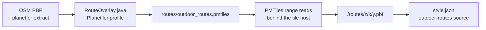

# Outdoor Routes Tile Archive

> Operator handover for the `outdoor_routes` extract: building it from OpenStreetMap with the Planetiler profile in this repository, serving it at `/routes/{z}/{x}/{y}.pbf`, and verifying it against the shipped style.

## 1. Purpose and scope

The archive is a single PMTiles file of line vector tiles carrying the member ways of OSM hiking and cycling route relations. It is built by [`docs/examples/RouteOverlay.java`](docs/examples/RouteOverlay.java) and consumed by the `outdoor-routes` source in `style.json`, whose block defines two route families — hiking and cycling — as width-tiered lines with `ref`/`name` badges. Every feature carries relation-level attributes rather than way-level ones, so the style tiers by `network` and separates the families by `route_type`.

The archive is one of four hosted tile services. The others are POIs (`/pois/`), paths (`/paths/`) and contours (`/terrain/`); only `/routes/` is built by this profile. Style-side rendering rules — colours, widths, casings, badge placement and draw order — are documented in [Activities](docs/8.activities.md). The other overlays are covered in [Tile Server](docs/7.server.md), [Outdoor POIs](docs/4.pois.md) and [Paths](docs/3.paths.md).



This document is for whoever runs the rebuild and whoever operates the tile host. It assumes access to a recent Planetiler jar, the OSM input, and the host that serves the archive.

## 2. The data contract

### Source declaration

| Property     | Value                                                                                                                                                                              |
| ------------ | ---------------------------------------------------------------------------------------------------------------------------------------------------------------------------------- |
| Source id    | `outdoor-routes` (hyphen) — the key in `style.sources` and the `source` on every route layer                                                                                       |
| Source-layer | `outdoor_routes` (underscore) — the layer name inside the tile                                                                                                                     |
| Tile URL     | `https://tile.ogis.app/routes/{z}/{x}/{y}.pbf`                                                                                                                                     |
| Format       | Mapbox Vector Tile (protobuf), one layer                                                                                                                                           |
| Geometry     | line (MVT geometry type 2)                                                                                                                                                         |
| Zoom         | source declared `minzoom: 8`, `maxzoom: 14`; the profile emits z8–14 inclusive                                                                                                     |
| Archive      | PMTiles, built to `routes/outdoor_routes.pmtiles`                                                                                                                                  |
| Attribution  | `© OpenStreetMap contributors` — written into the archive metadata by the profile's `attribution()`; the style does not read it (its credit comes from `metadata.attributionLine`) |

> [!WARNING]
> The source id and the source-layer differ by one character: `outdoor-routes` versus `outdoor_routes`. A layer that points at the wrong one renders nothing, and the style spec does not reject it. The URL directory is `routes` — neither `route` nor `outdoor-routes`.

The shipped style hardcodes `tile.ogis.app`. Serving the archive elsewhere only reaches the style if `ROUTES_TILE_URL` in [`scripts/build.mjs`](scripts/build.mjs) is changed and `style.json` is rebuilt in the same release.

### Attributes

Every attribute is a string. The profile copies relation tags onto each member-way feature; Planetiler drops null attributes, so an absent key means the relation did not carry that tag. All keys are lower-case snake_case; the OSM key `osmc:symbol` becomes `osmc_symbol`.

| Attribute     | Type   | Permitted values                                                                                              | Consumed by                                                                                                                                          |
| ------------- | ------ | ------------------------------------------------------------------------------------------------------------- | ---------------------------------------------------------------------------------------------------------------------------------------------------- |
| `route_type`  | string | `hiking` or `bicycle`; the profile emits it on every feature                                                  | the two unmarked line tiers and their casings (4 layers): hiking unmarked requires a value other than `bicycle`, cycling unmarked requires `bicycle` |
| `network`     | string | hiking: `iwn`, `nwn`, `rwn`, `lwn`; cycling: `icn`, `ncn`, `rcn`, `lcn`; absent when unmarked or unrecognised | all 20 line layers (network-tier filters) and all 4 badge layers (network-group filters)                                                             |
| `ref`         | string | free text, e.g. `SWCP`, `LAW16`, `LF4`                                                                        | 4 badge layers: first choice of badge text; its presence enables a badge                                                                             |
| `name`        | string | free text                                                                                                     | 4 badge layers: fallback badge text; its presence enables a badge                                                                                    |
| `osmc_symbol` | string | raw `osmc:symbol` value, e.g. `blue:white:red_lower:RL:black`                                                 | none — informational                                                                                                                                 |
| `operator`    | string | raw operator, e.g. `Wandelnet`                                                                                | none — informational                                                                                                                                 |
| `distance`    | string | raw OSM value, e.g. `12500` or `12.5 km`; not parsed                                                          | none — informational                                                                                                                                 |
| `ascent`      | string | raw OSM value in metres; not parsed                                                                           | none — informational                                                                                                                                 |
| `descent`     | string | raw OSM value in metres; not parsed                                                                           | none — informational                                                                                                                                 |
| `cai_scale`   | string | raw CAI hiking scale, e.g. `T`, `E`, `EE`, `EEA`                                                              | none — informational                                                                                                                                 |
| `roundtrip`   | string | raw OSM value, normally `yes` or `no`                                                                         | none — informational                                                                                                                                 |

Layer counts in the table describe the full two-family block. Each enabled family contributes five tier pairs (10 line layers) and two badge layers; a build with one family enabled has half the line and badge layers.

### Family separation and unmarked ways

`route_type` is the only attribute that separates the families. Marked tiers filter on `network` alone because the two vocabularies are disjoint: a hiking feature never carries `icn`/`ncn`/`rcn`/`lcn`, and a cycling feature never carries `iwn`/`nwn`/`rwn`/`lwn`.

- Hiking unmarked matches every feature whose `route_type` is not `bicycle` and whose `network` is outside the hiking set. This deliberately catches absent, empty and unknown `network` values, so no hiking way slips through without a line.
- Cycling unmarked requires `route_type=bicycle` and a `network` outside the cycling set.
- When both families are enabled, cycling is assembled before hiking in the style block, so where a way carries both activities the hiking line and badges paint over the cycling ones. There is no lateral offset and no dashed-overlay treatment on shared ways.

Absent or null `network` is unmarked by definition; the style's `coalesce` treats both as an empty value.

> [!WARNING]
> `route_type` is not optional. Without it the cycling unmarked tier cannot match anything, and the hiking unmarked tier draws cycling member ways as if they were hiking. A tile with route lines but no family separation almost always means the attribute was dropped.

| Defect                                       | What the style does                                                                                                                                                                    |
| -------------------------------------------- | -------------------------------------------------------------------------------------------------------------------------------------------------------------------------------------- |
| `route_type` absent                          | Cycling unmarked never matches (it requires `bicycle`); hiking unmarked absorbs every unmarked way, including cycling member ways. Marked tiers still match on `network`.              |
| `route_type` is any value other than the two | Unmarked ways fall into hiking unmarked, because its filter only excludes the literal `bicycle`; marked tiers still match on `network`.                                                |
| `network` absent or unrecognised             | The feature falls to its family's unmarked tier if `route_type` is correct, and never gets a badge.                                                                                    |
| `network` in the other family's vocabulary   | The profile normalises it away at build time. A hand-built archive that passes it through is drawn by the other family's marked tier, because marked tiers have no `route_type` guard. |
| `ref` and `name` both absent                 | The line renders without a badge.                                                                                                                                                      |
| `ref` present, `name` absent                 | The badge text is `ref`.                                                                                                                                                               |
| `name` present, `ref` absent                 | The badge text is `name`.                                                                                                                                                              |

The marked tiers do not read `route_type`. Correctness there rests on the profile normalising `network` per activity. Do not post-process network values without preserving that normalisation.

### Geometry and zoom

- One line feature per matched member way per relation. A way shared by two relations produces two features with different relation attributes; those features do not merge with each other.
- `postProcessLayerFeatures` calls `FeatureMerge.mergeLineStrings` on `outdoor_routes` with a 0.5 px minimum length, 0.1 simplification tolerance and 4 px buffer. Contiguous member ways with identical attributes merge into longer lines per tile, and a merged MVT feature can contain several line parts.
- `setMinPixelSize(0)` disables the default drop of sub-pixel features so short member ways survive to the merge step.
- Every feature gets `setZoomRange(8, 14)`. Planetiler's feature range is inclusive at the top; the style's source `maxzoom` of 14 is the last zoom with real tiles, and MapLibre overzooms that zoom at z15 and above. The style's width and text interpolations run to z16, so z15–16 rendering depends on the z14 tile being present.

## 3. OSM selection rules

The profile selects relations by tag, remembers their attributes, and emits their member ways. It does not classify ways by `highway` type.

| Rule                  | Behaviour                                                                                                                                                                                                                                                    |
| --------------------- | ------------------------------------------------------------------------------------------------------------------------------------------------------------------------------------------------------------------------------------------------------------ |
| Relation type         | `type=route` or `type=superroute`. Everything else — including `type=route_master` — is ignored.                                                                                                                                                             |
| `route` tag           | Split on `;`, each token trimmed. Tokens are case-sensitive.                                                                                                                                                                                                 |
| Hiking tokens         | `hiking`, `foot`, `walking` → `route_type=hiking`.                                                                                                                                                                                                           |
| Cycling token         | `bicycle` → `route_type=bicycle`.                                                                                                                                                                                                                            |
| Both activities       | A relation carrying any hiking token and `bicycle` is emitted once as hiking; hiking wins regardless of token order.                                                                                                                                         |
| Other `route` values  | `mtb`, `horse`, `ski`, `canoe` and the like are ignored.                                                                                                                                                                                                     |
| Proposed cycling      | `state=proposed` on a cycling relation → dropped.                                                                                                                                                                                                            |
| Cycling node networks | `network:type=node_network` on a cycling relation → dropped.                                                                                                                                                                                                 |
| Hiking exclusions     | None. A hiking relation tagged `state=proposed` or `network:type=node_network` is still selected.                                                                                                                                                            |
| `network`             | Read whole, not split on `;`. Normalised to the activity's vocabulary; anything unrecognised becomes absent.                                                                                                                                                 |
| Member ways           | Any way with line geometry (`canBeLine()`) that is a member of a matched relation, directly or through a superroute chain (`relationInfo(..., true)` recurses). No `highway` filter, so road, track, ferry and path sections all emit when they are members. |
| Attributes            | Copied from the relation, not the way.                                                                                                                                                                                                                       |
| Small features        | `setMinPixelSize(0)`, so thin and short ways are not dropped.                                                                                                                                                                                                |

Consequences worth knowing before diagnosing a build:

- **Hiking wins by construction.** The scan breaks on the first hiking token, while `bicycle` continues scanning. A later hiking token can therefore override an earlier `bicycle` token: both `route=bicycle;hiking` and `route=hiking;bicycle` become hiking.
- **Exclusions apply only to cycling.** They are evaluated after the activity resolves, so a dual-activity relation is never dropped as a proposed or node-network cycling relation.
- **Superroutes inherit downwards.** `relationInfo(..., true)` resolves parent relations recursively, so a way that is a member of a child relation also carries the attributes of any enclosing superroute and emits a separate feature for it. A superroute whose members are child relations therefore contributes through its own tags as well as through each child relation, and a way can legitimately appear once per enclosing relation.
- **`network` is not split.** `network=iwn;nwn` matches neither value and becomes absent, so the way renders unmarked. Only `route` is semicolon-split.
- **Only `proposed` is excluded.** `state=construction` and other lifecycle values are still selected.
- **No `highway` filter.** A long-distance route that follows roads emits those road ways too. That is intentional — the style draws route membership, not path quality — but it is the main reason a dense tile can be larger than expected.

## 4. Running the profile

### Prerequisites

- JDK 21 or newer.
- A recent Planetiler jar. The repository does not vendor one; the usage comment in the profile references `../.planetiler/planetiler.jar`. Any Planetiler release that provides the `Profile`, `FeatureCollector`, `FeatureMerge` and `Arguments` APIs used here works.
- Enough RAM and scratch disk for the chosen input (see the extract-versus-planet table below).
- The OSM input: a Geofabrik extract downloaded by Planetiler, or a local planet or extract PBF.

> [!WARNING]
> JDK 21 or newer is required. The profile targets a modern Planetiler, which does not run on Java 8. Check `java -version` and select the JDK explicitly (for example with `JAVA_HOME`) if the system default is older.

### Where the profile lives

The profile is [`docs/examples/RouteOverlay.java`](docs/examples/RouteOverlay.java) — a single-file Java profile with its own `main`, launched through the JDK's single-file source mode. The usage comment inside the file shows a `scripts/RouteOverlay.java` path and a `../.planetiler/planetiler.jar` classpath; both are illustrative. Use the actual paths in the checkout.

Run from a working directory where `data/sources/` and `routes/` should live. `main` resolves both with `Path.of(...)`, so they are relative to the process working directory, not to the profile file. The comment in `main` says "features/", but the code is working-directory-relative.

### Entry point and defaults

`main` sets `area`, `download` and `maxzoom`; the remaining defaults come from Planetiler. Command-line arguments override both. Arguments are read with `Arguments.fromArgsOrConfigFile(args)`.

In code terms, `main` resolves `data/sources/<area>.osm.pbf`, calls `addOsmSource("osm", osmPath, "geofabrik:" + area)`, then `overwriteOutput(Path.of("routes", "outdoor_routes.pmtiles"))` and `run()`.

| Flag                | Default                          | Effect                                                                                                                  |
| ------------------- | -------------------------------- | ----------------------------------------------------------------------------------------------------------------------- |
| `--area`            | `italy`                          | Names the Geofabrik extract (`geofabrik:<area>`), the cached input `data/sources/<area>.osm.pbf`, and the download URL. |
| `--download`        | `true`                           | Downloads the extract when the cached file is absent; an existing file is reused. `--download=false` never downloads.   |
| `--maxzoom`         | `14`                             | Top zoom Planetiler plans. Do not lower it for the hosted archive; the style expects z14.                               |
| `--minzoom`         | not set (Planetiler default `0`) | Pass `8` so the run plans no tiles below the feature range and the archive advertises z8.                               |
| `--bounds`          | none                             | `minLon,minLat,maxLon,maxLat`. Limits the tiles written, not the input read. Useful for a quick regional test.          |
| `--output`          | `routes/outdoor_routes.pmtiles`  | Overrides the archive path. The profile sets the default with `overwriteOutput`, so an existing archive is replaced.    |
| `--osm_path`        | `data/sources/<area>.osm.pbf`    | Overrides the input path, for example a local planet PBF.                                                               |
| `--osm_url`         | `geofabrik:<area>`               | Overrides the download URL. `aws:latest` resolves to the latest planet PBF.                                             |
| `--refresh_sources` | `false`                          | Re-downloads the input when it has changed. Without it, a cached PBF is reused indefinitely.                            |

`overwriteOutput` sets the output and overwrite behaviour; `--output` still wins. The input cache is reused whenever the file exists, so a weekly rebuild must either point `--osm_path` at a fresh file, delete the cached PBF, or pass `--refresh_sources=true`.

### Example commands

A country extract, writing `routes/outdoor_routes.pmtiles` relative to the working directory:

```bash
java -Xmx8g -cp /opt/planetiler/planetiler.jar \
  docs/examples/RouteOverlay.java \
  --area=netherlands \
  --download \
  --minzoom=8 \
  --maxzoom=14
```

A bounded test build over the Chamonix–Valais corridor. This reads the whole Italian extract but writes only the tiles that intersect the bounds:

```bash
java -Xmx8g -cp /opt/planetiler/planetiler.jar \
  docs/examples/RouteOverlay.java \
  --area=italy \
  --download \
  --bounds=6.70,45.85,7.90,46.30 \
  --minzoom=8 \
  --maxzoom=14
```

A full-planet build from a local PBF:

```bash
java -Xmx48g -cp /opt/planetiler/planetiler.jar \
  docs/examples/RouteOverlay.java \
  --osm_path=/srv/osm/planet-latest.osm.pbf \
  --download=false \
  --minzoom=8 \
  --maxzoom=14
```

The header's `--bounds` example follows the same shape; bounds are minLon,minLat,maxLon,maxLat.

### Extract versus planet

| Input                   | When to use                                                       | Rough resources                                                                                                  | Caveat                                                                                                                                |
| ----------------------- | ----------------------------------------------------------------- | ---------------------------------------------------------------------------------------------------------------- | ------------------------------------------------------------------------------------------------------------------------------------- |
| Geofabrik extract       | Development, a regional deployment, a smoke test                  | A few GB of heap and scratch roughly the size of the input plus the archive                                      | Routes that leave the extract are truncated; a long-distance route appears only inside the extract boundary.                          |
| Full planet PBF         | The hosted worldwide archive                                      | A large machine: budget tens of GB of RAM and several hundred GB of free scratch disk for input, output and temp | Longest run; no boundary truncation.                                                                                                  |
| Pre-filtered planet PBF | A cheaper planet-scale rebuild when a filtering tool is available | Less input and scratch; the same heap profile for the retained ways and nodes                                    | The filter must keep `type=route` or `type=superroute` relations, their member ways and all referenced nodes, or geometry disappears. |

These are starting points, not guarantees. Size the heap from the input's node index, not from the archive: the profile's output is small, but Planetiler must read every node and way to resolve member geometry.

### Expected output

`routes/outdoor_routes.pmtiles`, a PMTiles archive with one vector layer. `isOverlay()` returns true, so the archive metadata records the output as an overlay rather than a base layer. No sidecar files are required. Confirm the file is non-zero and starts with the seven bytes `PMTiles` before moving it anywhere.

## 5. Serving the archive

### Endpoint layout

| Service  | Endpoint                   | Source-layer     | Geometry | Archive                       |
| -------- | -------------------------- | ---------------- | -------- | ----------------------------- |
| POIs     | `/pois/{z}/{x}/{y}.pbf`    | `outdoor_pois`   | point    | the POI service               |
| Paths    | `/paths/{z}/{x}/{y}.pbf`   | `outdoor_paths`  | line     | the paths archive             |
| Routes   | `/routes/{z}/{x}/{y}.pbf`  | `outdoor_routes` | line     | `outdoor_routes.pmtiles`      |
| Contours | `/terrain/{z}/{x}/{y}.pbf` | `contours`       | line     | the on-demand contour service |

Only `/routes/` is built here. Each service has its own archive and zoom range; the style requests them independently.

### Range reads behind the tile host

Clients request individual zxy tiles, not the archive. The tile host maps `z/x/y` to a PMTiles tile ID, reads the archive header and directory, then reads the tile bytes — an HTTP Range request when the archive is on object storage, a positional file read when it is local. The archive must therefore be byte-addressable without transformation, and nothing between the tile process and the archive may recompress or rewrite the object. Do not put the `.pmtiles` object behind a proxy that strips or rewrites `Range`, and do not enable automatic compression on it.

### Response headers

| Header                        | Value                                                                                                          | Why                                                                                |
| ----------------------------- | -------------------------------------------------------------------------------------------------------------- | ---------------------------------------------------------------------------------- |
| `Content-Type`                | `application/x-protobuf`                                                                                       | MVT body; `application/vnd.mapbox-vector-tile` is also accepted                    |
| `Content-Encoding`            | `gzip` or `br`, matching the PMTiles header's tile compression                                                 | the client must know the body is compressed; omit it when sending identity         |
| `Access-Control-Allow-Origin` | `*`, or the demo and published style origins                                                                   | MapLibre fetches tiles cross-origin; include the header on 4xx/5xx responses too   |
| `Cache-Control`               | a short TTL with revalidation for the stable URL, or `public, max-age=31536000, immutable` for a versioned URL | the style URL has no content hash, so long-lived caching must be tied to a new URL |
| `ETag` / `Last-Modified`      | archive build identity or modification time                                                                    | revalidation during the TTL and after an atomic swap                               |
| `Accept-Ranges`               | `bytes`                                                                                                        | required on the archive object the tile process reads, not on the zxy response     |
| `Vary`                        | `Origin` when CORS echoes an origin; `Accept-Encoding` when negotiated                                         | cache correctness                                                                  |

### Required behaviour

- **PMTiles compression.** The archive header records the tile compression. Either pass the stored bytes through with the matching `Content-Encoding`, or decompress and send identity. Never gzip twice, and never send gzip bytes without the header.
- **CORS.** `*` is appropriate for public tiles. If the deployment restricts origins, allow the demo origin and the published style origin, and set the CORS header on error responses as well; otherwise the browser reports a CORS failure instead of the real status.
- **Caching.** The stable URL has no version segment. Use a short TTL (for example `max-age=300`) plus `ETag` during rebuilds, or introduce a version prefix or query, change `ROUTES_TILE_URL` in [`scripts/build.mjs`](scripts/build.mjs), rebuild `style.json`, and serve the versioned URL as immutable. Keep the previous version reachable until its TTL has expired.
- **HTTP/2.** Enable it. Route tiles arrive in bursts with the rest of the style's sources.
- **404 versus empty 200.** Return 404 when the PMTiles directory has no entry for the requested tile — no features, outside coverage, or outside z8–14. Do not return 200 with a zero-length or HTML body: clients treat it as a parse failure, and it hides a missing archive behind a success. Return 503 when the archive is missing, unreadable or the range read fails, so monitoring can tell "no data here" from "service broken".
- **404s are normal in open country.** A tile with no route features is legitimately absent. Every-tile 404s are a mount or zoom-range problem, not "no data".
- **Zoom range.** The archive must contain real tiles at z8–14 in covered areas. MapLibre trusts the source's declared `minzoom: 8` and `maxzoom: 14`: at z14 it requests z14 tiles and does not guarantee a fallback if they are absent, and at z15+ it overzooms the z14 tile. A server-side minzoom clamp above 8, or an archive that stops at z13, breaks the declared range even though the style is unchanged.

## 6. Rebuild and deploy

The hosted archive is rebuilt weekly from OpenStreetMap. A rebuild is a full re-extract, not an incremental diff; the weekly cadence is the freshness policy, not a technical requirement of the profile.

A route-only build is far cheaper than a full basemap build: the profile writes one layer and discards every way that is not a route member at feature collection, so the output and tile-writing cost are much lower. The input scan is still the whole PBF — Planetiler must read all nodes and ways to resolve member geometry. For a regional service, a Geofabrik extract is the cheap path. For the planet, the input read dominates and the machine is sized for it. A PBF pre-filtered to `type=route` or `type=superroute` relations, their member ways and their nodes reduces the input further, provided the filter preserves relation membership.

1. **Fetch a fresh input.** Point `--osm_path` at a new planet PBF, delete `data/sources/<area>.osm.pbf`, or pass `--refresh_sources=true`. Confirm the input's timestamp or replication sequence before starting.
2. **Build on a suitably sized host.** Use JDK 21 or newer, `--minzoom=8` and `--maxzoom=14`. Do not lower maxzoom to shrink the archive.
3. **Sanity-check the archive before it leaves the build host.** Check the `PMTiles` magic, compare the size with the previous archive, and — if the host has PMTiles tooling — confirm the header reports z8–14 and the expected bounds. A truncated archive can still start with `PMTiles`, so decode at least one reference tile as described in section 7.
4. **Copy to the host without touching the live file.** Write to a staging path on the same filesystem as the live archive, for example with `rsync --partial`. Verify the size or checksum.
5. **Swap atomically.** Keep dated archives and a `current.pmtiles` symlink: write the new symlink to a temporary name, then rename it over `current.pmtiles`. The rename is atomic on the same filesystem. Alternatively, `mv` the staged file over the live one on the same filesystem. Never overwrite the live file in place while the server is reading it.
6. **Keep the previous archive.** Retain the dated previous build until the next successful rebuild and until the cache TTL has passed. It is the rollback target.
7. **Probe the public endpoint.** Decode one reference tile and watch 5xx/404 rates and tile latency for the first minutes after the swap.
8. **Reload the tile process if it caches the archive.** A process that holds the PMTiles header and directory open at startup keeps serving the old inode; restart or signal it after the swap.

**Rollback:** repoint `current.pmtiles` to the previous archive (or rename it back), reload the tile process if needed, and confirm a reference tile still decodes. If the URLs are immutable and versioned, keep the old version mounted and reachable until its TTL expires; otherwise clients with a cached tile will keep the failed build for the duration of the TTL.

## 7. Verification

Run these checks in order after a build and again after a deploy. Replace `BASE` with the staging or production origin.

### 7.1 Probe a tile over HTTP

```bash
BASE=https://tile.ogis.app
curl -sS -D - -o utrecht-z13.pbf \
  "$BASE/routes/13/4212/2702.pbf"
```

Expected: `HTTP/2 200`, `content-type: application/x-protobuf`, a non-empty body (non-zero `content-length`), and the CORS header. Add `--compressed` only when the server sets `Content-Encoding`; the decode step below handles compressed and identity bodies either way.

### 7.2 Decode the tile

The repository has `pbf` and `@mapbox/vector-tile` in `node_modules` as transitive dependencies of `maplibre-gl`, which is enough to decode a tile fetched over HTTP. `pmtiles` and `tippecanoe` are not installed in this repository; archive-level inspection is the host's job.

```bash
node --input-type=module -e '
import { readFileSync } from "node:fs";
import { gunzipSync } from "node:zlib";
import Pbf from "pbf";
import { VectorTile } from "@mapbox/vector-tile";

let buf = readFileSync(process.argv[1]);
if (buf[0] === 0x1f && buf[1] === 0x8b) buf = gunzipSync(buf);

const tile = new VectorTile(new Pbf(buf));
const layer = tile.layers.outdoor_routes;
if (!layer) throw new Error("missing outdoor_routes: " + Object.keys(tile.layers));

const vocabulary = {
  hiking: new Set(["iwn", "nwn", "rwn", "lwn"]),
  bicycle: new Set(["icn", "ncn", "rcn", "lcn"]),
};
const counts = {};
for (let i = 0; i < layer.length; i++) {
  const feature = layer.feature(i);
  if (feature.type !== 2) throw new Error("feature " + i + " is not a line");
  const { route_type, network } = feature.properties;
  if (!(route_type in vocabulary))
    throw new Error("feature " + i + " has route_type=" + route_type);
  if (network !== undefined && !vocabulary[route_type].has(network))
    throw new Error("feature " + i + " has " + route_type + " network=" + network);
  const key = route_type + "|" + (network ?? "-");
  counts[key] = (counts[key] ?? 0) + 1;
}
console.log(layer.length + " line features");
console.table(counts);
' utrecht-z13.pbf
```

The script asserts the contract, not just decodability:

- the tile has an `outdoor_routes` layer;
- every feature is a line (MVT type 2);
- every feature has `route_type` set to `hiking` or `bicycle`;
- every present `network` belongs to the vocabulary of that feature's `route_type`;
- the printed counts show which tiers the tile actually carries.

`route_type` absent is a hard failure: it is the defect that collapses the family split. A tile with no `ref` or `name` on any feature is valid, but it will carry no badges, so sample more than one tile before concluding badges are broken.

> [!NOTE]
> An archive built before `route_type` existed fails this assertion by design. That is the intended signal, not a fault in the check.

### 7.3 Reference areas

| Area                     | Why it is useful                                                                                                             | Bounding box (lon/lat)  | Example tiles (XYZ)                                                                                    |
| ------------------------ | ---------------------------------------------------------------------------------------------------------------------------- | ----------------------- | ------------------------------------------------------------------------------------------------------ |
| Utrecht and surroundings | Dense `lcn`/`ncn`/`icn` cycling coverage in a flat, dense network; the same area also carries `lwn`/`rwn`/`nwn`/`iwn` hiking | 4.90,51.95 → 5.35,52.20 | z13 `4212/2702`; z14 `8425/5405`; sample x 4207–4217, y 2698–2707 at z13                               |
| Chamonix–Valais corridor | `ncn`/`rcn` cycling in alpine terrain, with hiking routes on the same tiles                                                  | 6.70,45.85 → 7.90,46.30 | z13 `4252/2916` (Chamonix), `4256/2911` (Martigny); z14 `8504/5833` (Chamonix), `8513/5822` (Martigny) |

Tiles are XYZ, so y increases south; do not compare them with TMS coordinates. A single tile can miss a route that runs just outside it, so sample the 3×3 neighbourhood before concluding that a network is absent. Networks are edited continuously in OSM; confirm the expected values on openstreetmap.org before treating a missing tier as a build fault.

### 7.4 Load the style and check rendering

Build the style with `npm run build` and start the compare app with `npm run dev`, or use the published style against the deployed tiles.

Check both reference areas at z13 and z14:

- `#13/52.0907/5.1214` and `#14/52.0907/5.1214` (Utrecht)
- `#13/45.9237/6.8694` and `#14/45.9237/6.8694` (Chamonix)
- `#13/46.102/7.073` (Martigny, Valais)

At both zooms, confirm route lines are visible and tiered, casings sit under fills, badges appear on marked networks, and the neutral dashed unmarked tier appears where a member way has no network. At z13 and z14 the marked tiers that the area carries should be present at their declared minzooms; z14 must not be blank or stale.

**Cycling beneath hiking.** When both families are enabled, the build assembles the cycling family first, so every cycling layer sits below every hiking layer. Check the generated style:

```bash
node -e '
const style = require("./style.json");
const ids = style.layers.map((layer) => layer.id);
const firstCycling = ids.findIndex((id) => id.startsWith("outdoor-cycling-routes-"));
const lastCycling = ids.findLastIndex((id) => id.startsWith("outdoor-cycling-routes-"));
const firstHiking = ids.findIndex((id) => id.startsWith("outdoor-routes-"));
if (firstCycling < 0 || firstHiking < 0)
  throw new Error("one family is absent from this build");
if (!(firstCycling < lastCycling && lastCycling < firstHiking))
  throw new Error("the cycling block is not entirely below hiking");
console.log("route layer order OK");
'
```

Run this against a build with both family toggles enabled; a single-family build legitimately lacks one prefix. On a shared way, the hiking line and badge paint over the cycling line.

**Unmarked isolation.** The two unmarked tiers use the same neutral grey, so colour cannot prove which family owns a feature. Use the rendered features' properties in the browser console, with both families enabled and the map panned over a dense area:

```js
const map = window.__outdoorsMaps.leftMap;
const hiking = map.queryRenderedFeatures({
  layers: ["outdoor-routes-unmarked"],
});
const cycling = map.queryRenderedFeatures({
  layers: ["outdoor-cycling-routes-unmarked"],
});
console.assert(
  hiking.every((f) => f.properties.route_type !== "bicycle"),
  "cycling leaked into the hiking unmarked tier",
);
console.assert(
  cycling.every((f) => f.properties.route_type === "bicycle"),
  "hiking leaked into the cycling unmarked tier",
);
```

The compare app exposes its maps as `window.__outdoorsMaps`. If the arrays are empty, pan to a feature first; an empty result proves nothing.

**Console and network.** With the Network panel filtered to `routes/`, every request inside the reference boxes at z8–14 should return 200 (or 404 where the tile genuinely has no routes). Confirm there are no CORS errors, no failed tile loads at z14, and no `styleimagemissing` errors — the last is a sprite problem, not an archive problem. The browser console should be clear.

**Style validation.** `npm run validate:style` must pass. It validates the shipped style against the MapLibre style spec and does not inspect the archive; the tile checks above cover the data.

## 8. Troubleshooting

| Symptom                                                     | Likely cause                                                                                                                                                                                                                        | Fix                                                                                                                                                                                                         |
| ----------------------------------------------------------- | ----------------------------------------------------------------------------------------------------------------------------------------------------------------------------------------------------------------------------------- | ----------------------------------------------------------------------------------------------------------------------------------------------------------------------------------------------------------- |
| Every `/routes/` request returns 404                        | Archive not mounted, wrong path root, server pointed at the wrong file, or the archive was built outside z8–14                                                                                                                      | Check the mount, symlink and server path mapping; confirm the PMTiles header and zoom range; rebuild with `--minzoom=8 --maxzoom=14`                                                                        |
| Tiles return 200 but nothing renders                        | Source-layer name mismatch (`outdoor_route` or `outdoor-routes` instead of `outdoor_routes`), wrong source id, or empty tiles                                                                                                       | Decode the tile; compare `style.sources["outdoor-routes"]`, the layer's `source` and its `source-layer`; confirm the tile actually contains `outdoor_routes` features                                       |
| Lines render but no badges                                  | `ref` and `name` both absent, or `network` missing/unknown (badges only exist on marked networks)                                                                                                                                   | Decode and inspect the properties; ensure the relation has `ref` or `name` and a recognised network value                                                                                                   |
| Cycling unmarked ways never render                          | `route_type` absent: the cycling unmarked filter requires `bicycle`                                                                                                                                                                 | Rebuild with the profile in this repository; decode and assert `route_type` on every feature                                                                                                                |
| Cycling ways draw in the hiking unmarked tier               | Same missing `route_type`; hiking unmarked only excludes the literal `bicycle`                                                                                                                                                      | As above. Do not work around it in the style                                                                                                                                                                |
| A cycling feature draws in a hiking colour on a marked tier | `network` carries a hiking value; marked tiers do not read `route_type`                                                                                                                                                             | Rebuild so the profile normalises network per activity; never hand-patch `network` without normalising                                                                                                      |
| Duplicate or stacked lines                                  | A way belongs to several relations; each relation emits its own feature and features with different attributes do not merge. Each tier draws its matching features once, so a shared way legitimately appears in more than one tier | Expected. The wider, higher network covers the narrower one. A visible lateral offset or a double-width line suggests duplicate features from the same relation or altered layer order, not normal stacking |
| One tile is enormous, or a single relation dominates a tile | A continent-spanning relation's attributes attach to thousands of member ways in one tile, and merging adds geometry                                                                                                                | Decode and group by `name`/`ref` to identify the relation. Accept the size, or exclude or split that relation as a data decision; do not lower `--maxzoom` to hide it                                       |
| A dense grey web appears in the Netherlands or Belgium      | Cycling node networks (`network:type=node_network`) got through, or dense `lcn` non-node routes are present                                                                                                                         | Confirm the archive was built with the profile in this repository; node networks are out of scope and should be excluded at selection. Check `network:type` on the parent relation                          |
| Tiles are oversized in dense cycling countries              | Many `lcn`/`rcn` relations share ways, and the 4 px merge buffer adds geometry                                                                                                                                                      | Expected. Monitor p95 tile size, ensure gzip/brotli, and tune the simplification or minimum length in `postProcessLayerFeatures` only as a deliberate profile change                                        |
| z14 is blank and the console reports failed tile loads      | The archive was built with `--maxzoom` below 14, or its PMTiles header stops at z13; the style declares maxzoom 14 and requests z14                                                                                                 | Rebuild with `--maxzoom=14`; verify a z14 reference tile decodes                                                                                                                                            |
| z8–z11 marked tiers are missing while high zooms work       | Archive built with `--minzoom` above 8, or the server clamps minzoom; `iwn`/`nwn` start at z8 and `rwn`/`rcn` at z9                                                                                                                 | Rebuild with `--minzoom=8`; remove any server-side clamp and confirm the PMTiles header minzoom                                                                                                             |
| CORS failure in the console                                 | Missing `Access-Control-Allow-Origin`, including on error responses, or an origin allowlist that omits the demo or published origin                                                                                                 | Set `*` or the exact origins; add `Vary: Origin` when echoing; test with `curl -H 'Origin: https://…' -I`                                                                                                   |
| Parse error or `Unimplemented type` when loading tiles      | Double compression, gzip bytes without `Content-Encoding`, a proxy re-compressing the response, or an HTML error page returned with 200                                                                                             | Align the PMTiles header's tile compression with the response header; disable proxy compression on the endpoint; return 4xx/5xx for errors, never 200 with HTML                                             |
| Badges appear but the text is blank                         | `ref` or `name` is whitespace, which passes the presence filter but renders nothing; a long `ref` can also drop the badge                                                                                                           | Clean the OSM tag; the style does not truncate badge text and drops a badge rather than clipping it                                                                                                         |

## 9. Boundaries and open decisions

### Fixed because the style depends on them

These values are a contract. Changing any of them is a coordinated change to the profile and the style, not an archive-only change.

- Source id `outdoor-routes`, source-layer `outdoor_routes`, vector format, line geometry and the `/routes/{z}/{x}/{y}.pbf` path.
- The z8–14 range, including real z14 tiles.
- One archive and one source-layer for both families, separated by `route_type`.
- `route_type` values `hiking` and `bicycle`.
- Network vocabularies `iwn|nwn|rwn|lwn` and `icn|ncn|rcn|lcn`; absent `network` means unmarked.
- One feature per member way, carrying relation-level attributes, with contiguous same-attribute ways merged per tile.
- Badge text precedence `ref` then `name`, and the requirement that at least one is present for a badge.

Changing the source id, source-layer, URL or tier vocabularies means editing the constants and tier tables in [`scripts/build.mjs`](scripts/build.mjs) and the profile together, then rebuilding `style.json`.

### Operational choices

- Extract versus planet, the `--area`/`--bounds` selection, and whether to pre-filter the PBF.
- Machine size, heap, scratch disk, and whether to use `--refresh_sources`.
- Cadence. Weekly is the project norm, but the operator can choose another interval.
- PMTiles server implementation, storage backend, HTTP protocol, compression policy and cache TTL.
- Staging path, atomic-swap mechanism, previous-archive retention and monitoring thresholds.
- Whether to serve a versioned tile URL. That requires a matching `ROUTES_TILE_URL` change and a style release.

### Deliberately deferred

- **Cycling node networks.** Excluded at selection because their dense short-hop webs need their own density and styling rules. Revisiting them would be a new overlay decision, not a profile tweak.
- **Proposed cycling routes.** Excluded while they are not signposted on the ground.
- **Per-way hiking membership for a dashed overlap treatment.** The profile carries only relation-level attributes, so a shared way cannot be marked as "also hiking" on the cycling line. A dashed overlay or lateral offset would need a new way-level attribute plus new style layers.
- **A separate cycling archive or a versioned `/routes/` layout.** Both families stay in one archive and one source-layer so the style needs one source. Splitting them would change the style's source model.
- **MTB, equestrian, ski and other route families.** Out of scope; only `hiking`/`foot`/`walking` and `bicycle` are selected.
- **Styling the informational attributes.** `osmc_symbol`, `operator`, `distance`, `ascent`, `descent`, `cai_scale` and `roundtrip` are carried so a future style can use them without rebuilding the archive.

### Minimum acceptance for a new archive

A new archive is ready to swap when: the file starts with `PMTiles`; its header covers z8–14; the Utrecht and Chamonix–Valais sample tiles decode with a valid `route_type` on every feature and the expected networks; a build with both family toggles enabled renders both families at z13 and z14 with cycling beneath hiking; and the browser console shows no errors and no unexpected `/routes/` 404s.
