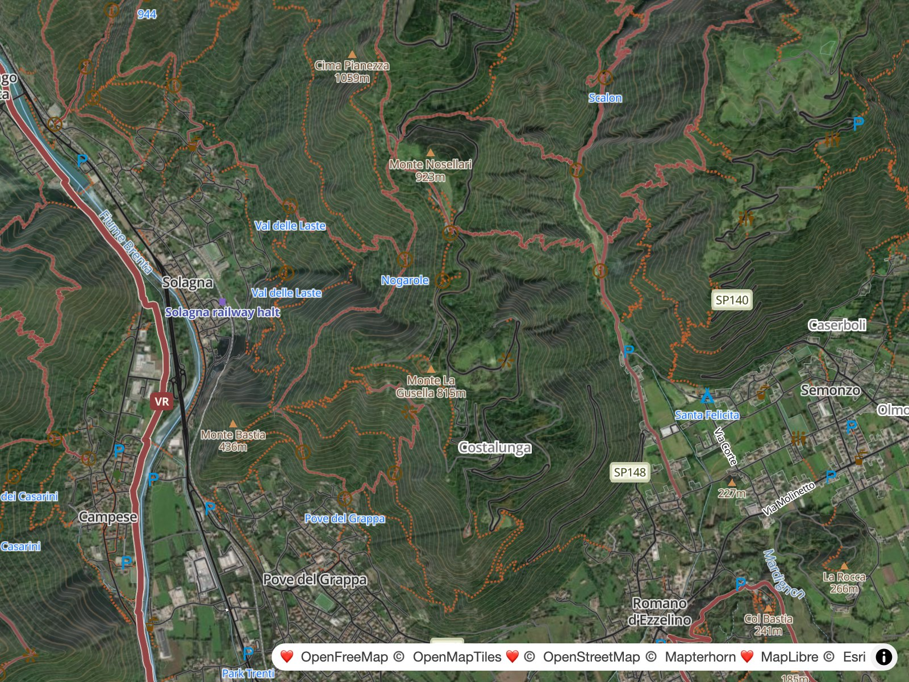

# Style Structure

> Outdoors is a thin outdoor modification on the [OpenGIS Basemap](https://www.ogis.org/basemap/) — the vendored OpenMapTiles OSM style v3.16 pointed at OpenFreeMap planet tiles.

[](https://www.ogis.org/outdoors/#13/45.81321/11.74098)

## The Basemap Foundation

The OpenGIS Basemap (published at <https://www.ogis.org/basemap/>, upstream repo: [opengis/basemap](https://github.com/opengis/basemap)) provides an excellent world map featuring:

- Vector [OpenStreetMap](https://www.openstreetmap.org/) data ([OpenMapTiles](http://openmaptiles.org/) schema v3.16).
- Human-readable layer ids (`Grass`, `Water`, `Footway path`, `Zoo`, `Mountain peak labels`…).
- Self-hosted glyphs and sprite at `www.ogis.org/basemap` (the sprite is re-wrapped as the `default` sheet of a two-sheet array — see [Extending the Icon Set](#extending-the-icon-set)).
- Tiles at `tiles.openfreemap.org/planet`.
- Attribution — build-owned via the [`ATTRIBUTION`](../scripts/build.mjs) block: the basemap string is synchronised onto both the live `openmaptiles` source and the basemap's `attribution` pseudo-source; never strip it (licence requirement).

The build orders its modifications through a single bottom-to-top [`RENDER_STACK`](../scripts/build.mjs) array of render bands, walked by `applyModifications()` (see [Natural Earth & the Ground Raster](10.natural-earth.md)). When the satellite ground feature is enabled, the build blends the Esri World Imagery raster over the natural-earth vectors — above the calibrated landcover/landuse fills, beneath the water and every later layer — and the late imagery legibility pass recedes the contours, tones the man-made surfaces, swaps the base `Building` fill for `building-outline` and adds the `building-3d` massing. On top of the basemap the build layers the DEM hillshade, contour lines and labels, the two outdoor-POI layers, the three low-zoom path layers, and the waymarked hiking- and cycling-route linework with badges on the marked networks and mixed green where the activities share a way.

Outdoors keeps most of the basemap's rendering and applies outdoor modifications on top — recolouring the core canvas, natural-earth landcover/landuse, water and park palettes, adding the DEM and contours, restyling roads and paths, and layering the hosted POI and waymarked-route overlays; when the satellite ground feature is enabled it also blends the imagery over the natural-earth vectors, so the vector ground reads through rather than being replaced.

> [!IMPORTANT]
> The style is generated programmatically; see [Build Script](1.build.md). Each feature has a toggle; flip it and rebuild (this is automatic in the dev app).

## Modification Groups

All modifications live in [`applyModifications()`](../scripts/build.mjs) in [`scripts/build.mjs`](../scripts/build.mjs), ordered by its bottom-to-top [`RENDER_STACK`](../scripts/build.mjs) of render bands and gated by `FEATURES` toggles. [`FINISHING_PASSES`](../scripts/build.mjs) runs after the walk for cross-group overrides. The groups below follow the band order; see [Natural Earth & the Ground Raster](10.natural-earth.md) for the full group table.

- **Core canvas & natural-earth** — the `Background` floor and the calibrated landcover/landuse fills (grass/wood greens, warm rock/sand/farmland tones, glacier) plus park differentiation (lighter park fill, darker national-park boundary, dark green park labels). Under the raster the vectors are retained and the imagery composites over them (`applyCorePalette()`, `applyNaturalEarthPalette()`, `applyParkDifferentiation()`). See [Natural Earth & the Ground Raster](10.natural-earth.md).
- **Ground raster** — when enabled, the `esri-satellite` raster source and `satellite` layer blend Esri World Imagery over the natural-earth vectors: inserted at the first water layer, so the raster sits above the vectors and below the water, and painted at a zoom-ramped `raster-opacity`. `applyGroundRetention()` strips any layers in the `SAT_STRIP_LAYERS` carry-over and `applyWaterTint()` makes the water fills translucent; the late `applyImageryLegibility()` pass recedes the contour opacity ramp, widens the small road/street label halos, tones down the remaining man-made surfaces (translucent urban fills, desaturated/faded runway tarmac, lightly muted rails), fades the national-park boundaries, swaps the base `Building` fill for the `building-outline` line layer and adds the `building-3d` fill-extrusion (`applySatelliteGround()`, `applyGroundRetention()`, `applyWaterTint()`, `applyImageryLegibility()`). See [Build Script](1.build.md).
- **Water palette** — water fills & lines recoloured (`applyWaterPalette()`).
- **DEM** — the `demSource` raster-dem (Mapterhorn, Terrarium encoding, declared at 256 px while Mapterhorn serves 512 px), the `hillshade-layer` inserted above landcover/landuse and below water, and the style's `terrain` property at 1.2 exaggeration (`applyDemSource()`, `applyDemHillshade()`, `applyDemTerrain()`). See [Elevation & Terrain](5.dem.md) and [Performance](9.performance.md).
- **Contours** — the hosted contour source, the `contour-lines` layer and the `contour-labels` elevation labels (`applyContours()`, `applyContourLabels()`). See [Elevation & Terrain](5.dem.md).
- **Road surface awareness** — a paved/unpaved hierarchy on the basemap's road fill layers: tiered asphalt greys (major/medium/local), neutral darker casings replacing the basemap's vivid outline hues, surface-aware widths with an earthy dashed unpaved treatment, bridge fills matching their tier, and tunnel fills faded so their dashes read (`applyRoadSurfaceAware()`). See [Build Script](1.build.md).
- **Path styling** — the basemap's Footway/Bridleway/Cycleway/Steps path family unified into the outdoor trail look, gated to z14+ (`applyPathStyling()`). See [Paths](3.paths.md).
- **Low-zoom paths** — the hosted `outdoor-paths` overlay owning z9–13 (`applyLowZoomPaths()`). See [Paths](3.paths.md).
- **Waymarked routes** — the hosted `outdoor-routes` overlay in the `routes` band between `borders` and `labels-poi`: hiking and cycling tier families from one `ROUTE_ACTIVITIES` registry, ivory casings, `ref`/`name` badges on the marked networks and mixed green on ways shared by both enabled activities (`applyRouteOverlay()`). Cycling draws beneath hiking. See [Activities](8.activities.md).
- **Outdoor POIs** — the config-driven POI layers (`applyOutdoorPoi()`): the hosted `outdoor-poi` overlay plus the `outdoor-amenities` planet layer. See [Outdoor POIs](4.pois.md).

## Labels

- **Peak labels** are native to the basemap: `Mountain peak labels` and `Volcano peak labels` (name + elevation at z12+, with peak/volcano icons).
- **Contour labels** are inserted just below the peak label layers, so contours beat POI labels in collisions but yield to peaks.
- **Park labels** — `Local park` and `National park labels` are recoloured to a dark green.

## Outdoor Overlays

- **Low-zoom paths** — a hosted overlay fills the z9–13 gap left by OpenMapTiles' zoom-gated path data (nothing below z12, only route members at z12–13), styled as one visual family with the basemap path layers. See [Low-zoom paths overlay](3.paths.md).
- **Outdoor POIs** — an overlay (huts, shelters, viewpoints, campsites, castle, toilets, playgrounds…) from the hosted extract, plus the `outdoor-amenities` planet layer reading doctors, banks and bicycle rentals straight from the OMT tiles. See [Outdoor POIs](4.pois.md).
- **Waymarked routes** — a hosted overlay of OSM hiking- and cycling-route member ways. Hiking and cycling are peers sharing one `outdoor-routes` source (`outdoor_routes`, z8–14); each feature carries `activity` (its own activity) and `activities` (the relation's full set in priority order), which the style uses for ownership. `ROUTE_ACTIVITIES` lists the activities in draw order — cycling below, hiking above — and each descriptor supplies its toggle, colour, badge icon and tier table. Each activity is one hue across its four marked networks — `COLOURS.ROUTES.HIKING` (oxblood, `#8e3b3b`) for hiking (`iwn`/`nwn`/`rwn`/`lwn`) and `COLOURS.ROUTES.CYCLING` (indigo, `#46589f`) for cycling (`icn`/`ncn`/`rcn`/`lcn`) — with hierarchy by width from the shared `ROUTE_WIDTHS` ladder, widest at international and narrowing through national and regional to local, with the neutral unmarked tier narrower still. Each tier draws a 1.35× ivory (`#fff8f0`) casing beneath its fill; marked lines are solid at the rank's fill and casing alphas. Ways without a network in the activity's vocabulary form its neutral warm-grey (`#6f6862`) unmarked tier from z12, dashed `[4, 2]` with no badge. Layer ids are symmetric: `outdoor-routes-<activity>-<tier>[-casing]` for lines and `outdoor-routes-<activity>-badges-<major|local>` for badges, with no separate cycling namespace. Badge symbol layers repeat shields on the marked networks only, labelled with `ref` (falling back to `name`) — major badges from z10 for international and national routes, local badges from z12 for regional and local — using `outdoors:route_marked_hiking`, `outdoors:route_marked_cycling` or `outdoors:route_marked_mixed`. `applyRouteOverlay()` builds each enabled activity from its `ROUTE_ACTIVITIES` descriptor, drawing the tiers lowest first (unmarked, local, regional, national, international) so a segment shared by several routes takes the highest network's width. The highest enabled activity owns a way shared by several activities; when both activities are enabled it paints mixed green (`#3f7a4f`) and the lower activity's layers exclude it, so no extra layers are needed. The whole block is inserted after the `Disputed border` linework and before the first label layer (`River labels`), so routes sit above transportation and boundaries but below every label. See [Activities](8.activities.md).

See [Tile Server](7.server.md) for more details on the hosted tiles behind the POIs, routes, paths and contours.

## Extending the Icon Set

Outdoors owns a small sprite sheet of its own, layered over the basemap's. The style's `sprite` property is an **array** of `{id, url}` pairs — the MapLibre multi-sprite object form (maplibre-gl v5 rejects string arrays and requires absolute URLs, so a relative URL is impossible). [`build()`](../scripts/build.mjs) writes it unconditionally:

```json
"sprite": [
  { "id": "default", "url": "https://www.ogis.org/basemap/sprite" },
  { "id": "outdoors", "url": "https://www.ogis.org/outdoors/sprite" }
]
```

Each sheet loads independently under its id; icons are referenced as `<id>:<name>` for a named sheet, or bare `<name>` — a bare name resolves only against the `default` sheet (MapLibre keys non-default sheets as `id:name`, with no fallback, so an outdoors icon referenced bare would never render). The basemap sheet stays `default` so the basemap's own layer references are untouched. The outdoors sheet's icon inventory lives in `OUTDOOR_SPRITE_ICONS` in [`scripts/build.mjs`](../scripts/build.mjs); every icon there is referenced with the `outdoors:` prefix — the POI icons through `outdoorIcon()`, the route badges with their literal prefixed names. `information` uses the basemap's `office` icon and `ranger_station` the basemap's `wilderness_hut` icon, both bare default-sheet references.

The same sheet carries the waymarked-route badge shields: `route_marked_hiking` in oxblood, `route_marked_cycling` in indigo and `route_marked_mixed` in mixed green. Each is one plain 14×14 full-bleed rounded rectangle rather than an icon with a transparent margin, with cream text; all paint fully opaque, so the pill reads as the exact route token rather than blending with the ground. `icon-text-fit: both` stretches the shield around its label at render time, so one flat shape per activity serves every `ref`/`name` length. There are no per-network shields and no unmarked badge: each activity's marked networks share its one shield, shared ways use the mixed shield when both activities are enabled, and unmarked ways carry no badge at all.

### Adding an Outdoor Icon

1. **Drop an OpenMapTiles-style SVG in `icons/`** — 14×14 flat-fill colour-coded silhouettes (8×8 for tiny point icons), matching the basemap's icon family. The route badge shields are the exception — plain full-bleed rounded rectangles that `icon-text-fit` stretches around their text.
2. **Run `npm run sprite:build`** — [`scripts/build-sprite.mjs`](../scripts/build-sprite.mjs) runs the native `spreet` binary over `icons/` and writes `dev/public/sprite.{json,png,@2x.json,@2x.png}`, verifying the sprite keys exactly match the icon set. The files are committed; Vite copies `dev/public` → `demo/` on `demo:build`.
3. **Reference it** in a layer's `icon-image` — the build's `outdoorIcon()` helper adds the `outdoors:` prefix for POI icons (the route badges use literal prefixed names); every other icon is a bare `<name>` resolving against the basemap's `default` sheet (e.g. `office`, `wilderness_hut`, `camping`).
4. **The checker validates it** — `npm run check:pois` resolves every literal `icon-image` in `style.json` against its own sheet: bare values must exist in the basemap's default sprite, `outdoors:`-prefixed values in the local sheet (never the union), plus an orphan check that every icon in the outdoors sheet is referenced with the prefix, and a token-template scan (`[1c]`) that fails on any surviving `{class}`/`{subclass}` template. See [Outdoor POIs](4.pois.md).

### Basemap POI icons

The basemap's own POI layers use dynamic templates (`{subclass}`, `{class}`) whose resolved names are often missing from the default sheet, so the build rewrites each into a single `match` — curated pairs (bespoke outdoors glyphs and near-miss default-sheet literals) first, then identity pairs for every remaining default-sheet key, landing on `outdoors:dot`. Because MapLibre raises `styleimagemissing` for any `["image", …]` probe whose name is missing, the match is built against the real key list (`fetchSpriteKeys()`) instead of probing. See [Build Script](1.build.md) and [Outdoor POIs](4.pois.md).

> [!NOTE]
> **Local development** — while `style.json` ships the absolute `https://www.ogis.org/outdoors/sprite` URL, the compare app rewrites the `outdoors` sheet to the Vite-served `/sprite` at runtime when `import.meta.env.DEV` ([`dev/src/App.vue`](../dev/src/App.vue)), and the screenshot harness does the same ([`scripts/screenshots/generate.mjs`](../scripts/screenshots/generate.mjs)), so icons under active development render before a deploy. The basemap `default` sheet stays remote.

> [!NOTE]
> **Deploy dependency** — the outdoors sheet URL is absolute (`https://www.ogis.org/outdoors/sprite`) and only exists once the demo deploys (push to master → GitHub Pages), so the icons render on the deployed site.

---

**← [Build Script](1.build.md) · [Paths](3.paths.md) →**
