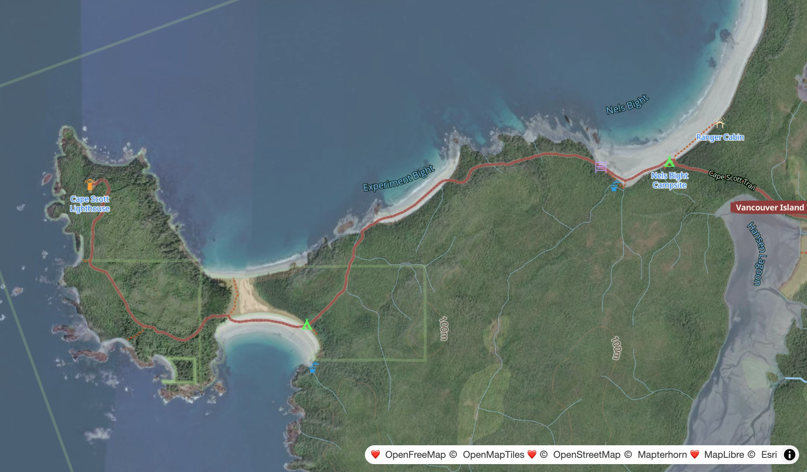

# Outdoor POIs

> POIs for the outdoors.

## Two Tiers

The outdoor POI system is two-tiered, both config-driven:

- **Overlay** — the `outdoor-poi` source. [`applyOutdoorPoi()`](../scripts/build.mjs) adds the `outdoor-poi` vector source (`https://tile.ogis.app/pois/{z}/{x}/{y}.pbf`, source-layer `outdoor_pois`, z12–16) and the `outdoor-poi` symbol layer (minzoom 12). This tier carries the kinds OMT lacks entirely (trailhead, pass, ranger_station, lighthouse, skiing…) and the kinds the overlay wants from z12 rather than OMT's z14 data floor. A `symbol-sort-key` derived from each kind's `priority` decides collision order (lower = placed first), mirroring the basemap's rank-as-sort-key convention.
- **Planet layer** — OMT data rendered directly. The `outdoor-amenities` symbol layer draws three OMT `poi` classes (doctors, bank, bicycle_rental) straight from the basemap's `openmaptiles` source at z14+. Its sort key sits at 1000 — above the overlay ladder — so basemap POIs (rank 20–2000, lower = first) place first and these amenities win only against the least-important ranks.

The two layers stack just above the basemap's POI stack (`Zoo`): `outdoor-amenities` directly above it, `outdoor-poi` above that (so overlay POIs win collisions), both below the contour labels.

## Config — `scripts/poi-config.mjs`

[`scripts/poi-config.mjs`](../scripts/poi-config.mjs) is the single source of truth for both tiers, imported by the build and the checker so the two can never drift.

[`OUTDOOR_POI`](../scripts/poi-config.mjs) drives the overlay: `sourceId`, `tileUrl`, `sourceLayer`, the zoom bounds and the `kinds` array. Each kind declares:

- **kind** — the category value carried by the tiles
- **icon** — the sprite glyph. The overlay's glyphs all live in the outdoors sheet, so `outdoorIcon()` prefixes each with `outdoors:`; a bare name would resolve only against the basemap's `default` sheet. The glyph's colour comes from its roles in [`palette.json`](../palette.json) (see [Extending the Icon Set](#extending-the-icon-set))
- **handoffZoom** — the zoom at which the basemap's own POI layer takes over (`null` = the basemap never draws that kind)
- **showEle** — whether the label includes the elevation
- **priority** — the symbol-sort-key weight (lower = placed first = wins collisions), mirroring the basemap's rank-as-sort-key convention. The ladder runs 10 (outdoor identity: hut, pass, trailhead, ranger_station) → 50 (information, parking); [`scripts/poi-config.mjs`](../scripts/poi-config.mjs) is the source of truth for the full mapping.

| kind             | icon                      | handoff | notes                                         |
| ---------------- | ------------------------- | ------- | --------------------------------------------- |
| `hut`            | `outdoors:alpinehut`      | 17      | basemap Accommodation z17; elevation in label |
| `shelter`        | `outdoors:shelter`        | —       | no basemap layer; elevation in label          |
| `viewpoint`      | `outdoors:viewpoint`      | 15      | basemap Attraction z15; elevation in label    |
| `campsite`       | `outdoors:camping`        | 16      | basemap Campsite z16                          |
| `picnic_site`    | `outdoors:picnic`         | —       | no basemap layer                              |
| `drinking_water` | `outdoors:drinking_water` | 18      | basemap Waste z18                             |
| `trailhead`      | `outdoors:trailhead`      | —       | no basemap layer                              |
| `pass`           | `outdoors:pass`           | —       | elevation in label                            |
| `ranger_station` | `outdoors:wilderness_hut` | —       | elevation in label                            |
| `castle`         | `outdoors:castle`         | 15      | basemap Cultural z15                          |
| `information`    | `outdoors:board`          | 16      | basemap Public z16                            |
| `parking`        | `outdoors:parking`        | 17      | basemap Transport z17                         |
| `park`           | `outdoors:park`           | 15      | basemap Local park z15                        |
| `toilets`        | `outdoors:toilets`        | 18      | basemap Waste z18                             |
| `playground`     | `outdoors:playground`     | 16      | basemap Outdoor z16                           |
| `ferry`          | `outdoors:ferry`          | 15      | basemap Ferry z15                             |
| `lighthouse`     | `outdoors:lighthouse`     | —       | no basemap layer                              |
| `skiing`         | `outdoors:skiing`         | —       | no basemap layer                              |

[`PLANET_POI`](../scripts/poi-config.mjs) drives the planet tier: it reuses the basemap's existing `openmaptiles` source (source-layer `poi`, minzoom 14), and its `kinds` array declares three OMT classes:

| class            | icon             | label       |
| ---------------- | ---------------- | ----------- |
| `doctors`        | `doctors`        | icon only   |
| `bank`           | `bank`           | icon only   |
| `bicycle_rental` | `rental_bicycle` | icon + name |

Each entry declares `class`, `icon`, `showTitle` (whether the label includes the name) and `priority`. The icons live in the basemap's default sprite, with an `outdoors:dot` fallback that never renders since every class has an explicit icon. The planet priority is 1000 — deliberately above the overlay ladder: the basemap's own POI layers sort by feature rank (20–2000, lower = first), so a ladder value would let doctors/bank/bicycle_rental outrank nearly every basemap POI they collide with. 1000 keeps basemap POIs first, these amenities winning only against the least-important ranks (≥1000).

## Handoff

Each overlay kind renders only below its handoff zoom (`POI_FILTER`); at/above it the basemap's own POI layer named in the table takes over (Attraction z15, Cultural z15, Ferry z15, Local park z15, Campsite z16, Outdoor z16, Public z16, Accommodation z17, Transport z17, Waste z18), so there are no duplicates and no gaps. Labels are `name` plus elevation for the `showEle` kinds (`POI_TEXT_EXPR`); icons map kind → sprite glyph via `POI_ICON_MATCH`, with `outdoorIcon()` prefixing the outdoors-owned icons and an `outdoors:dot` fallback that never renders, since every kind has an explicit icon. Collision order comes from `POI_SORT_KEY_MATCH` — a match over kind → priority (lower = placed first), with a 50 fallback that never fires because the filter only admits configured kinds.

Handoff parity is enforced on the basemap side too. [`applyBasemapPoiIcons()`](../scripts/build.mjs) rewrites the basemap's dynamic POI templates through `BASEMAP_POI_ICON_REMAP` and rewrites literal icon names that match a palette icon, so the basemap layers that take over for the remapped kinds (Campsite, Ferry, Outdoor, Waste, Transport, Cultural, Accommodation) draw the same project glyphs as the overlay below them. Those kinds therefore keep one glyph and colour across the seam rather than switching to the basemap's own icon.

The planet layer has no handoff — it draws classes no basemap POI filter matches (`doctors`, `bank`, `bicycle_rental`), directly from the same `openmaptiles` source the basemap reads.

> [!NOTE]
> **Deploy dependency** — the outdoors-owned icons (`OUTDOOR_SPRITE_ICONS` in [`scripts/build.mjs`](../scripts/build.mjs) is derived from `palette.json`'s registry) live in the outdoors sheet and are referenced with the `outdoors:` prefix; the sheet is served from an absolute URL (`https://www.ogis.org/outdoors/sprite`) that only exists once the demo deploys — the icons render on the deployed site. In local development the compare app and the screenshot harness rewrite this to the locally built `/sprite` so icons render before a deploy. See [Extending the Icon Set](#extending-the-icon-set).

## Checker — `npm run check:pois`

[`scripts/check-poi-coverage.mjs`](../scripts/check-poi-coverage.mjs) runs the following checks against the built `style.json` and the shared config, exiting 1 on any failure. The bracketed labels match the script's console output.

`npm run palette:check` is the companion gate for the icon artwork: it validates `palette.json` against the `icons/` sources — including role references, map references, unused roles, slot fills and the outline configuration — and verifies the committed `sprite.lock.json`, failing when the lock is missing or any digest differs and naming the missing lock or stale entry. It needs no rendered directory or `spreet`, so it runs on a clean checkout; CI runs it alongside this check.

1. **`[1]` Sprite validation** — every literal `icon-image` value in `style.json` must exist in its **own sheet** (never the union): bare values in the basemap sprite (`https://www.ogis.org/basemap/sprite.json`, ETag-cached), `outdoors:`-prefixed values in the local outdoors sheet (`dev/public/sprite.json`, built by `npm run sprite:build` — the check fails with a clear error telling you to run it if the sheet is missing). A prefixed value is split at its first `:` and resolved against the named sheet. Dynamic expressions are skipped (token templates should no longer exist — see the scan below).
2. **`[1b]` Orphan icons** — every icon key in `dev/public/sprite.json` must be referenced with the `outdoors:` prefix somewhere in `style.json`, so the sheet can never silently grow an icon that the `palette.json` registry registers but the style never draws.
3. **`[1c]` Token-template scan** — no symbol layer's `icon-image` may still contain a `{class}`/`{subclass}` template. Those resolve at render time by substring substitution and raise `styleimagemissing` for names the sprite lacks, so the build rewrites them into the curated-plus-identity `match` expressions (see [Build Script](1.build.md)); this check catches a build-side regression rather than a browser-console warning. Recursion reaches match values, fallbacks and `["image", name]` literals.
4. **`[2]` Kind coverage** — the `outdoor-poi` layer exists, references the `outdoor-poi` source, and every kind in `OUTDOOR_POI.kinds` appears in its filter.
5. **`[2b]` Sort priority** — every kind in `OUTDOOR_POI.kinds` carries a numeric `priority`, and the `outdoor-poi` layer's `symbol-sort-key` is a match over `kind` covering every kind at its config priority.
6. **`[3]` Planet layer** — the `outdoor-amenities` layer exists with the correct source/source-layer/minzoom, its filter contains every class in `PLANET_POI.kinds`, and its `symbol-sort-key` covers every class at its config priority (its icons are already covered by check `[1]`).

## Extending the Icon Set

Outdoors owns a small sprite sheet of its own, layered over the basemap's — the outdoor-POI overlay glyphs, the handoff-parity and curated basemap-POI glyphs the icon remap draws on (soccer, tennis, ruins…) and the waymarked-route badge shields (`route_marked_hiking`, `route_marked_cycling`, `route_marked_mixed`).

The sheet is a raster PNG, not an SDF atlas, so each glyph's colour is baked into the rendered SVG when `spreet` builds the sheet. Style paint `icon-color` and `icon-halo-*` can neither recolour nor halo it. Icon fill colours are defined once in [`palette.json`](../palette.json): each icon names `primary` and optional `detail` roles, the authored `icons/<name>.svg` carries `__primary__`/`__detail__` fill slots, and [`scripts/palette.mjs`](../scripts/palette.mjs) resolves the roles into gitignored `build/icons/*.svg`. A pale glyph marked `outline: true` also gets a baked keyline from the shared `iconOutline` role and width, because style paint cannot add one at render time.

To add a coloured POI, author `icons/<name>.svg` with the slot fills, register it in `palette.json`'s `icons` map with its roles and optional `outline`, run `npm run palette:build` (optional; `npm run sprite:build` renders first), then `npm run sprite:build` (which also rewrites `sprite.lock.json`), then `npm run build` to write the new reference into `style.json`. Point the kind's `icon` in `OUTDOOR_POI` at the name, or a curated `BASEMAP_POI_ICON_REMAP` pair at it; the build's `outdoorIcon()` helper adds the `outdoors:` prefix for POI icons. The build wires the sheet into `style.json`'s `sprite` array. `npm run palette:check` validates the palette and the `icons/` sources and verifies the sprite lock; `npm run check:pois` validates every `icon-image` against its own sheet (bare → basemap, prefixed → named), runs the orphan check, and scans for any surviving `{class}`/`{subclass}` template. See [Style Structure](2.style.md).

---

**← [Paths](3.paths.md) · [Elevation & Terrain](5.dem.md) →**
