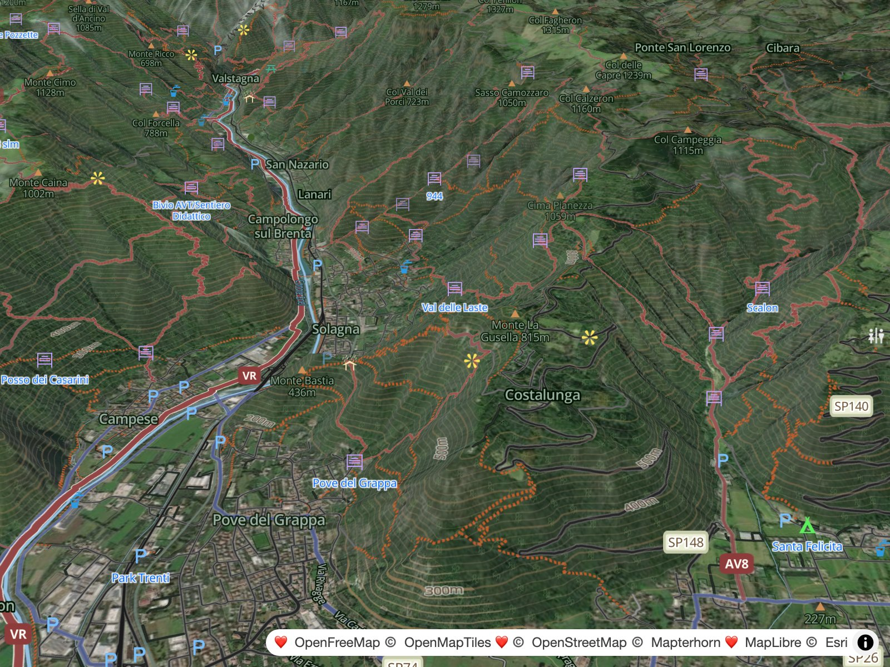
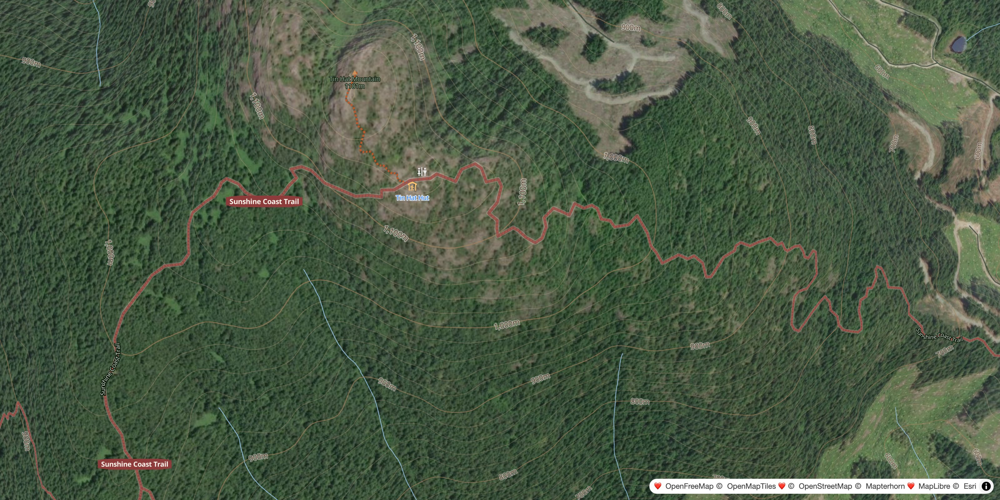

# Elevation & Terrain

> Hillshading and terrain relief from the Mapterhorn DEM, plus a separate contour overlay.

[](https://www.ogis.org/outdoors/#13.03/45.81048/11.73434/-27.6/60)

> [!WARNING]
> **Known Issues**
>
> - DEM features are limited by Mapterhorn Coverage (https://mapterhorn.com/coverage/); many areas do not show contours at higher zooms. Might be worth comparing with the Mapzen dataset.
> - Contour labelling is too sparse.

The build script wires the DEM in once as a `raster-dem` source (`demSource`), which feeds two client-rendered consumers:

- **Hillshade** — a `hillshade` layer that fades in across the low zooms.
- **Terrain** — the style's `terrain` property, enabling 3D relief in clients that support it.

Contours are a separate vector source, styled as lines and elevation labels (see [Contours](#contours)).

> [!NOTE]
> The compare app can also drive hillshading and 3D terrain on its left (provider) map directly from the same Mapterhorn endpoint, independent of the style build — useful for like-for-like 3D comparison. See [The Compare App](6.client.md#dem-overlays).

## Source Configuration

The build adds the raster-dem source once ([`applyDemSource()`](../scripts/build.mjs)): id `demSource`, tiles `https://tiles.mapterhorn.com/{z}/{x}/{y}.webp`, Terrarium encoding, maxzoom 15 (`DEM_SOURCE_MAXZOOM`), and the `© Mapterhorn` credit from `ATTRIBUTION.MAPTERHORN`. Mapterhorn's z16 coverage has gaps, and the resulting 404s left the terrain mis-sampled at high pitch, so the source overzooms complete z15 tiles instead — visually indistinguishable in stills.

Mapterhorn serves its tiles at **512 px**, but the style declares the source at **256 px** (`DEM_SOURCE_TILESIZE` in [`scripts/build.mjs`](../scripts/build.mjs)). Halving the declared size cuts the terrain mesh and hillshade texture work to build — measured at ~+23% fps at pitched high-zoom views, visually indistinguishable in stills. See [Performance](8.performance.md).

> [!IMPORTANT]
> **Consumer tip — terrain LOD.** Terrain level-of-detail is a **map-level** option (`setSourceTileLodParams()`), not a style property, so it cannot ship inside `style.json`. Consumers who enable the style's `demSource` should apply a LOD cap after the map loads. The compare app does exactly this, for both panes. See [Performance](8.performance.md) and [Client-side rendering](6.client.md#dem-overlays).

## Hillshade

[`applyDemHillshade()`](../scripts/build.mjs) adds the `hillshade-layer` (type `hillshade`, source `demSource`). Its `hillshade-exaggeration` paint is a linear zoom ramp — 0 at z3 → 0.2 at z5 → 0.2 at z12 (constant `HILLSHADE_EXAGGERATION`) — so relief fades in across the low zooms and stays steady through the mid-range. The layer is inserted at the water stack index (above landcover/landuse, below water).

## Terrain

[`applyDemTerrain()`](../scripts/build.mjs) sets the style's `terrain` property:

```js
style.terrain = { source: "demSource", exaggeration: TERRAIN_EXAGGERATION };
```

`TERRAIN_EXAGGERATION` is 1.2 — the ratio by which the terrain is exaggerated relative to the real world. Declaring `style.terrain` enables 3D terrain rendering: clients that support the style-spec `terrain` property (MapLibre GL JS / MapLibre Native) lift the map surface from the DEM, so pitched views show genuine relief.

## Contours

[](https://www.ogis.org/outdoors/#15.3/49.980138/-124.377551)

The contour overlay is a separate vector source — `contour-source`, `https://tile.ogis.app/contours/{z}/{x}/{y}.pbf`, source-layer `contours`, z9–14 — styled as lines and elevation labels like any other vector source. It is gated by the `CONTOURS` toggle and is independent of the client DEM.

### Layers

Two layers are added by [`applyContours()`](../scripts/build.mjs) and [`applyContourLabels()`](../scripts/build.mjs). `contour-lines` is inserted after the river bridge outline (above the water fills, below the road stack); `contour-labels` is inserted just below the basemap's peak label layers — see [Label placement](#label-placement) below.

| Layer            | Type   | Purpose                                                                                                                                                                              |
| ---------------- | ------ | ------------------------------------------------------------------------------------------------------------------------------------------------------------------------------------ |
| `contour-lines`  | line   | Minor and index contours in a single layer — a `case` expression on the elevation value switches style per line, hiding lines that fall off the 20 m minor cadence (`ele % 20 == 0`) |
| `contour-labels` | symbol | Line-placed elevation text, emitted only on index lines                                                                                                                              |

Both layers are styled from the `CONTOURS` map tokens in [`palette.json`](../palette.json), exposed to the build as `COLOURS.CONTOURS` — the minor/index/label colours — with the width and opacity ramps covered in [Line Rendering](#line-rendering) below. See [The Style Build](1.build.md) for how the palette and per-feature config work.

### Line Rendering

The single `contour-lines` layer distinguishes index contours (every 100 m, `ele % 100 === 0`) from the minor lines between them with a `case` expression, then paints both through three-stop zoom ramps (z9 → z13 → z14) defined in `applyContours()` and the `CONTOUR_OPACITY_*` / `CONTOUR_WIDTH_*` constants. `CONTOUR_MID_ZOOM` (z13) is the middle stop and sets ramp position.

### Label Placement

MapLibre resolves symbol collisions from the top of the stack down — the highest label layer places first and wins the space. `contour-labels` is therefore inserted just below whichever of the basemap's peak label layers (`Mountain peak labels` / `Volcano peak labels`) comes first in the stack. The collision order this produces:

- peaks win over contour labels;
- contour labels win over POI labels (`outdoor-poi`);
- town/place labels (above all of these) still win.

### Label layout

`contour-labels` places text along the line (`symbol-placement: line`) with `text-padding: 4` and a `text-size` ramp of 11 px @ z12 → 13 px @ z14 — the tighter padding lets elevation text fit along more of each line. Labels stay metric at build time (see [Units](#units)).

### Zoom ceiling

> [!WARNING]
> **Do not raise the source maxzoom above z14** — contours stair-step visibly at z15+.

The style declares the contour source maxzoom at z14 (`CONTOUR_SOURCE_MAXZOOM`); the line and label layers overzoom beyond it. The geometry follows the DEM's pixel grid, so beyond z14 the grid stair-steps.

### Units

The style ships metric-only — the label expression renders the rounded `ele` value with an `"m"` suffix. Imperial conversion is a client-side concern, not part of the style. See [Metric vs Imperial](6.client.md#metric-vs-imperial).

## Other elevation data

Not every elevation value in the style comes from the Mapterhorn DEM:

- **Basemap peak labels** — `Mountain peak labels` and `Volcano peak labels` (native to the basemap) carry `{ele} m` from the OpenMapTiles `mountain_peak` source-layer — vector-tile attributes, not the DEM. See [Style Structure](2.style.md).
- **POI `ele` attribute** — the outdoor-POI `showEle` kinds (`hut`, `shelter`, `viewpoint`, `pass`, `ranger_station`) carry an `ele` attribute read from the OSM `ele` tag on the `outdoor-poi` tiles. The tiles emit it as a string, and `POI_TEXT_EXPR` coerces it with `to-number` before rounding for the label. See [Outdoor POIs](4.pois.md).

> [!NOTE]
> The basemap no longer ships a pre-shaded Natural Earth relief raster; relief now comes solely from the Mapterhorn DEM hillshade. The calibrated natural-earth vector ground is a separate concept — see [Natural Earth & the Ground Raster](9.natural-earth.md).

---

**← [Outdoor POIs](4.pois.md) · [Client-side rendering](6.client.md) →**
