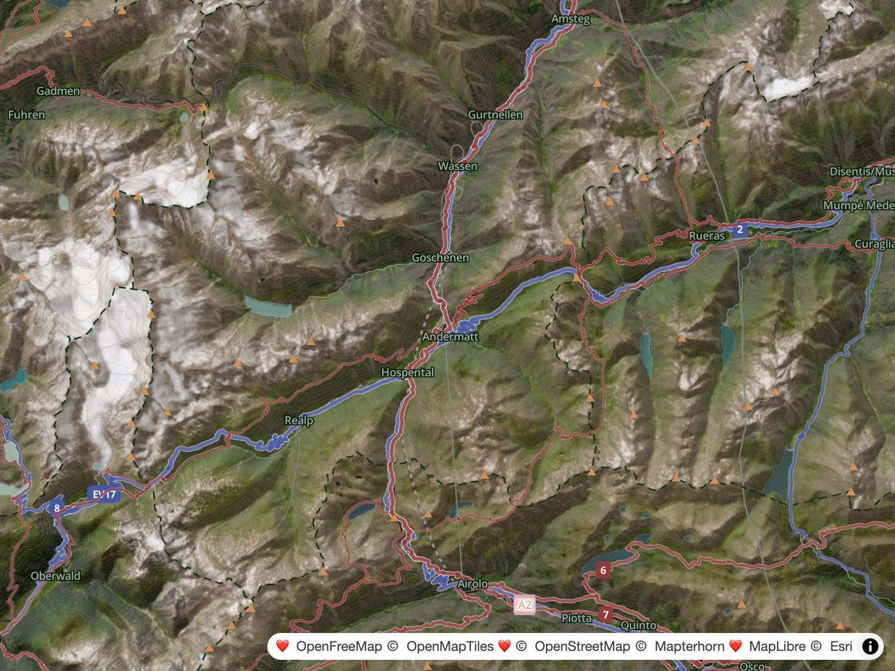

# Activities

> The `WAYMARKED_HIKING_ROUTES` and `WAYMARKED_CYCLING_ROUTES` toggles gate the two waymarked-route activities — peer line families on one `outdoor-routes` source.

Waymarked hiking and cycling routes draw as width-tiered line families from vector tiles — one hue per activity across its four marked networks, plus a shared neutral unmarked treatment — with badges on the marked networks only.

## Waymarked routes

OSM route relations become line vector tiles, so long-distance routes read as a hierarchy on the map. Hiking and cycling are peers on the same source.

| Property     | Value                                                                                 |
| ------------ | ------------------------------------------------------------------------------------- |
| Source id    | `outdoor-routes` (hyphen)                                                             |
| Source-layer | `outdoor_routes` (underscore)                                                         |
| Tile URL     | `https://tile.ogis.app/routes/{z}/{x}/{y}.pbf`                                        |
| Geometry     | line                                                                                  |
| Zoom         | source z8–14                                                                          |
| Style wiring | `ROUTE_OVERLAY` and `ROUTE_ACTIVITIES` in [`scripts/build.mjs`](../scripts/build.mjs) |

> [!WARNING]
> The source id and source-layer differ by one character: `outdoor-routes` versus `outdoor_routes`. The URL directory is `routes`.

### Feature contract

Each line feature carries the relation's attributes:

- **`activity`** — this feature's activity, `hiking` or `cycling`. It selects the activity's tier family.
- **`activities`** — the full activity set for the relation that produced the feature, semicolon-separated in priority order (`hiking;cycling`). The style uses it for ownership, because `activity` alone cannot express shared membership.
- **`network`** — the relation's network in this activity's own vocabulary: `iwn`/`nwn`/`rwn`/`lwn` for hiking, `icn`/`ncn`/`rcn`/`lcn` for cycling. Absent means unmarked.
- **`name`**, **`ref`** — drive the badges; `ref` wins, `name` is the fallback.

> [!NOTE]
> **Legacy compatibility.** When `activity` is absent, the style infers it: `network` first (the cycling vocabulary means cycling, the hiking vocabulary hiking), then a legacy `route_type=bicycle`, and finally hiking. A missing `activities` falls back to the single inferred activity. This exists only to read older tiles; current tiles carry `activity` and `activities`.

### Activity registry and tiers

`ROUTE_ACTIVITIES` in [`scripts/build.mjs`](../scripts/build.mjs) is the style's activity registry in draw order, bottom to top: cycling, then hiking. Each descriptor carries the activity id, its feature toggle, its colour token, its badge icon and its tier table. Both activities use the same five-rank shape, in draw order lowest to highest: each tier entry carries an explicit `rank` (`unmarked`, `local`, `regional`, `national`, `international`), and the shared width and opacity tables are keyed on it.

| Rank          | Hiking tier | Cycling tier | From | Linework                      |
| ------------- | ----------- | ------------ | ---- | ----------------------------- |
| Unmarked      | `unmarked`  | `unmarked`   | z12  | Dashed neutral, softer casing |
| Local         | `lwn`       | `lcn`        | z12  | Solid, activity colour        |
| Regional      | `rwn`       | `rcn`        | z9   | Solid, activity colour        |
| National      | `nwn`       | `ncn`        | z8   | Solid, activity colour        |
| International | `iwn`       | `icn`        | z8   | Solid, activity colour        |

The two tables are symmetric: same ranks, zoom gates and linework; only the network vocabulary differs. Each marked tier id doubles as its `network` filter; the unmarked tier matches a feature whose `network` is absent or outside the activity's own marked set. Tiers draw lowest first, so a segment shared by several networks takes the highest network's width.

**Network vocabularies.** The two vocabularies are disjoint, so a dual relation with a hiking network yields a marked hiking feature and an unmarked cycling feature.

### Width, opacity and colour

Widths, fill opacity and casing opacity are keyed by rank, not by activity, so both activities share one hierarchy:

| Rank          | Width stops (px)                               | Fill alpha | Casing alpha |
| ------------- | ---------------------------------------------- | ---------- | ------------ |
| Unmarked      | z12 1.6 → z14 2.0 → z16 2.6                    | 0.5        | 0.25         |
| Local         | z12 1.8 → z14 2.6 → z16 3.6                    | 0.65       | 0.3          |
| Regional      | z9 1.6 → z11 2.4 → z13 3.4 → z15 4.8 → z16 5.2 | 0.65       | 0.3          |
| National      | z8 1.6 → z10 2.5 → z12 3.5 → z14 5 → z16 6.6   | 0.57       | 0.4          |
| International | z8 2 → z10 3.2 → z12 4.4 → z14 6.6 → z16 8.8   | 0.57       | 0.4          |

- **Casing** — each tier draws a 1.35× ivory (`#fff8f0`) casing beneath its fill.
- **Solid vs dashed** — marked lines are solid; the unmarked line is dashed `[4, 2]` with a butt cap.
- **Joins & caps** — every tier uses a round join; marked caps are round.
- **Alpha composition** — fill and casing alphas compound where they overlap. `applyRouteOverlay()` emits every colour as a native `rgba()` string through `routeColour()`, so the alphas compose without a `line-opacity` paint property.

| Token / icon                    | Value                  | Used by                        |
| ------------------------------- | ---------------------- | ------------------------------ |
| `COLOURS.ROUTES.HIKING`         | `#8e3b3b` (oxblood)    | hiking marked fills            |
| `COLOURS.ROUTES.CYCLING`        | `#46589f` (indigo)     | cycling marked fills           |
| `COLOURS.ROUTES.MIXED`          | `#3f7a4f` (deep green) | shared ways, both toggles on   |
| `COLOURS.ROUTES.UNMARKED`       | `#6f6862` (warm grey)  | unmarked fills                 |
| `COLOURS.ROUTES.CASING`         | `#fff8f0` (ivory)      | every casing                   |
| `outdoors:route_marked_hiking`  | hiking shield          | hiking badges                  |
| `outdoors:route_marked_cycling` | cycling shield         | cycling badges                 |
| `outdoors:route_marked_mixed`   | mixed shield           | badges on shared ways, both on |

### Ownership and mixed green

The highest enabled activity owns a way shared by several activities. `buildRouteActivityLayers()` works this out from the enabled `ROUTE_ACTIVITIES` order:

- For a lower activity, the base filter requires `activity` to match and `activities` not to include any higher enabled activity, so its duplicate feature is excluded from its layers.
- For the highest enabled activity, the base filter is just `activity`. If a lower activity is enabled, the fill adds a `case` on `activities`: when the way also belongs to the lower activity, the fill is mixed green; otherwise it is the activity colour.
- Mixed green applies at every rank, including unmarked: a shared way with no marked network is a green dashed line in the unmarked tier.
- With only one activity enabled there is no mixed condition, because only that activity's duplicate renders. Shared ways keep that activity's colour.
- Badges follow ownership: when both activities are enabled, a shared way's badge is drawn by the owning activity's badge layer and uses `outdoors:route_marked_mixed`; with only one activity enabled, it keeps that activity's own shield.

No extra layers are added: disabling an activity removes its layer block, and the other activity then owns every way it carries.

> [!NOTE]
> Mixed green is a style behaviour. The tiles only have to carry `activities`; the style can paint green only when both activity toggles are enabled and `activities` names both activities.

### Badges

Badge symbol layers repeat a shield along the marked lines only:

- `major` from z10 for national and international networks; `local` from z12 for regional and local networks.
- Text is `ref`, falling back to `name`. A feature with neither emits no badge. Badge text is not truncated; a long `ref` can cause placement to drop the badge rather than clip it.
- `symbol-placement: line`, `symbol-spacing` 400, `symbol-avoid-edges: true`.
- `Noto Sans Bold`, cream text `#fff8f0`, text size 9 at z10, 11 at z14, 12 at z16.
- `icon-text-fit: both` with 2/4/2/4 padding, so one full-bleed shield serves every label length.
- Fully opaque: no `icon-opacity` or `text-opacity` is set, so the shield shows the exact route token rather than blending with the ground.
- Badge layers are built in two groups: `major` (national and international, minzoom 10), then `local` (regional and local, minzoom 12), so the local layer sits above the major one in the style.

The shields are listed in the expected icon set in [`scripts/build-sprite.mjs`](../scripts/build-sprite.mjs). Unmarked ways carry no badge because they have no waymarked network.

### Render placement

Layer ids are symmetric and derive from the source id, activity id and tier:

- lines: `outdoor-routes-<activity>-<tier>` and `outdoor-routes-<activity>-<tier>-casing`
- badges: `outdoor-routes-<activity>-badges-<major|local>`

There is no separate cycling namespace; the block is inserted after the `Disputed border` linework and before the first label layer (`River labels`), falling back to the end of the stack if neither anchor exists — so routes sit above transportation and boundaries but below every label. The style wiring is in [Style Structure](2.style.md#outdoor-overlays).

### Design rationale

The underlying path network is burnt-orange (`#c05a2a`) and reads as capillaries; the waymarked routes are the larger vessels above it. Hiking uses oxblood as arteries and cycling indigo as veins, while a way shared by both enabled activities turns deep green so the overlap is legible as one line rather than two competing ones. Hierarchy comes from a quiet width ladder with casings and no glow or gradient, so the activities read as one system without adding a second competing palette.

Thanks to [Waymarked Trails: Hiking](https://hiking.waymarkedtrails.org/#help-about) and [Waymarked Trails: Cycling](https://cycling.waymarkedtrails.org/#help-about), which have lots of useful information and also offer mtb, riding (equestrian), skating and slopes (skiing) in addition to hiking and cycling.

### Adding an activity

Adding an activity is a style-side change: the config, layers, colours, badges and these docs. The steps below use `mtb` as a placeholder id.

1. **Choose the id and draw position.** Pick the activity id and its position in `ROUTE_ACTIVITIES` (draw order, bottom to top).
2. **Add the style descriptor.** Add an entry to `ROUTE_ACTIVITIES` in [`scripts/build.mjs`](../scripts/build.mjs) with the id, `FEATURES` toggle, `COLOURS.ROUTES` colour token, badge icon and tier table.
3. **Add the tier table.** Create a five-rank tier table in draw order — unmarked, local, regional, national, international — reusing the shared ranks where the hierarchy fits. `ROUTE_WIDTHS`, `ROUTE_FILL_OPACITY` and `ROUTE_CASING_OPACITY` are keyed by rank; `ROUTE_BADGE_GROUPS` is an array of `{suffix, minzoom, ranks}` groups, grouped by rank. Only add a new rank if the existing five cannot express the activity, then extend all four tables together.
4. **Add the feature toggle.** Add the boolean to `FEATURES` beside the existing route toggles, and add the new layer ids to the `routes` band's `layers` metadata in `RENDER_STACK`.
5. **Add the badge icon.** Add an SVG to `icons/`, add its name to `OUTDOOR_SPRITE_ICONS` and `EXPECTED_ICONS` in [`scripts/build-sprite.mjs`](../scripts/build-sprite.mjs), then run `npm run sprite:build`; reference it as `outdoors:<name>`.
6. **Update the docs.** Update this page, the build and style descriptions, the `routes` band in the render stack, and the benchmark layer ids.
7. **Verify.** Run `npm run build`, `npm run demo:build`, `npm run validate:style` and `npm run check:pois`; render with the new toggle on and confirm tier order, badges and ownership against the existing activities.

---

**← [Client-side rendering](6.client.md) · [Performance](8.performance.md) →**
