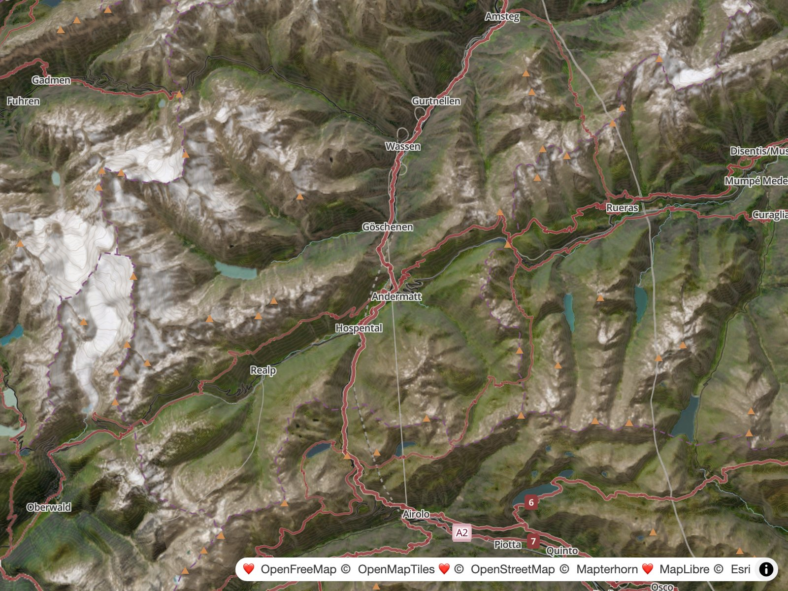
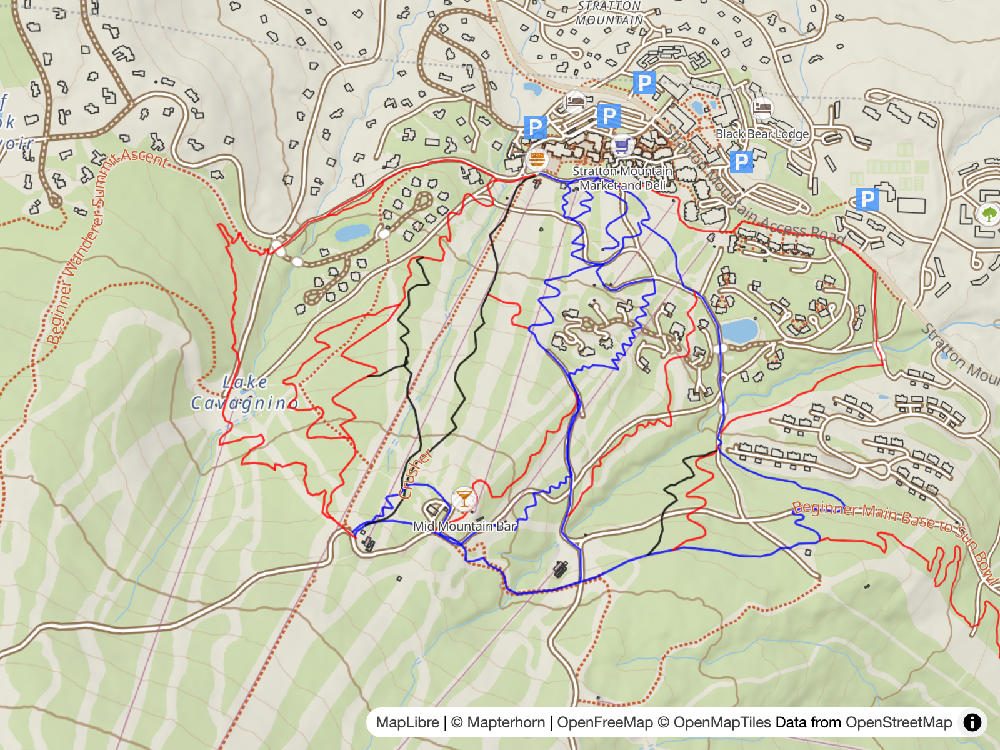

# Activities

> The `WAYMARKED_HIKING_ROUTES` and `WAYMARKED_CYCLING_ROUTES` toggles gate the two waymarked-route activities; both read one hosted `outdoor-routes` source. Other activity layers remain reference implementations.

Waymarked hiking and cycling routes are peer activities drawn from hosted vector tiles as width-tiered line families — one hue per activity across its four marked networks, plus a shared neutral unmarked treatment — with badges on the marked networks only. Both hosted OSM line overlays are generated by Planetiler Java profiles in [`docs/examples/`](examples/): [`examples/FootpathOverlay.java`](examples/FootpathOverlay.java) for the low-zoom paths overlay and [`examples/RouteOverlay.java`](examples/RouteOverlay.java) for the routes overlay. See [Tile Server](7.server.md).

## Waymarked routes

OSM route relations become line vector tiles, so long-distance routes read as a hierarchy on the map. The hosted service is listed at [`tile.ogis.app/sources`](https://tile.ogis.app/sources) as a PMTiles-backed vector service: a single worldwide archive rebuilt weekly from OpenStreetMap. Hiking and cycling are peers on the same source.

| Property     | Value                                                                                 |
| ------------ | ------------------------------------------------------------------------------------- |
| Source id    | `outdoor-routes` (hyphen)                                                             |
| Source-layer | `outdoor_routes` (underscore)                                                         |
| Tile URL     | `https://tile.ogis.app/routes/{z}/{x}/{y}.pbf`                                        |
| Geometry     | line                                                                                  |
| Zoom         | source declared z8–14; the profile emits z8–14 inclusive                              |
| Style wiring | `ROUTE_OVERLAY` and `ROUTE_ACTIVITIES` in [`scripts/build.mjs`](../scripts/build.mjs) |

> [!WARNING]
> The source id and source-layer differ by one character: `outdoor-routes` versus `outdoor_routes`. The URL directory is `routes`.

### Feature contract

The extract emits one line feature per member way per activity and copies the relation's attributes onto it:

- **`activity`** — this feature's activity, `hiking` or `cycling`. It selects the activity's tier family.
- **`activities`** — the full activity set for the relation that produced the feature, semicolon-separated in priority order (`hiking;cycling`). The style uses it for ownership, because `activity` alone cannot express shared membership.
- **`network`** — the relation's network in this activity's own vocabulary: `iwn`/`nwn`/`rwn`/`lwn` for hiking, `icn`/`ncn`/`rcn`/`lcn` for cycling. Absent means unmarked.
- **`name`**, **`ref`** — drive the badges; `ref` wins, `name` is the fallback.
- **`osmc_symbol`**, **`operator`**, **`distance`**, **`ascent`**, **`descent`**, **`cai_scale`**, **`roundtrip`** — informational attributes copied from the relation when present; unstyled.

A dual-activity relation emits two features per member way, one per activity, and both carry the same `activities`. `activities` is relation-scoped: it lists the activities the relation survived under, not a union across every relation that touches the way. After per-tile merging, contiguous member ways with identical attributes combine into longer lines, so tile feature counts are not way counts.

> [!NOTE]
> **Legacy compatibility.** The style infers an activity when `activity` and `activities` are absent: `network` first (the cycling vocabulary means cycling, the hiking vocabulary hiking), then a legacy `route_type=bicycle`, and finally hiking. This exists only to read older archives; a current archive carries `activity` and `activities`.

The operator runbook — full schema, selection rules, profile operation, serving and verification — is [`ROUTES.md`](../ROUTES.md). This page covers how the style consumes the archive.

### Activity registry and tiers

`ROUTE_ACTIVITIES` in [`scripts/build.mjs`](../scripts/build.mjs) is the style's activity registry in draw order, bottom to top: cycling, then hiking. Each descriptor carries the activity id, its feature toggle, its colour token, its badge icon and its tier table. The extract's own registry runs in the reverse order — hiking first — because it builds the `activities` string highest priority first; the two orders answer different questions and are kept separate.

> [!WARNING]
> Planetiler stores exactly one `OsmRelationInfo` per relation id. The extract therefore returns one relation record per relation, carrying the full `activities` set and a per-activity network map, and `processFeature()` emits one feature per activity. Returning one record per activity would keep only the last one written and silently drop an activity from dual relations.

Both activities use the same five-rank shape, in draw order lowest to highest. Each tier entry carries an explicit `rank` (`unmarked`, `local`, `regional`, `national`, `international`); the shared width and opacity tables are keyed on it.

| Rank          | Hiking tier | Cycling tier | From | Linework                      |
| ------------- | ----------- | ------------ | ---- | ----------------------------- |
| Unmarked      | `unmarked`  | `unmarked`   | z12  | Dashed neutral, softer casing |
| Local         | `lwn`       | `lcn`        | z12  | Solid, activity colour        |
| Regional      | `rwn`       | `rcn`        | z9   | Solid, activity colour        |
| National      | `nwn`       | `ncn`        | z8   | Solid, activity colour        |
| International | `iwn`       | `icn`        | z8   | Solid, activity colour        |

The two tables are symmetric: same ranks, zoom gates and linework; only the network vocabulary differs. Each marked tier id doubles as its `network` filter; the unmarked tier matches a feature whose `network` is absent or outside the activity's own marked set. Tiers draw lowest first, so a segment shared by several networks takes the highest network's width.

**Selection.** Hiking matches the `route` tokens `hiking`, `foot` and `walking` and has no exclusions. Cycling matches `bicycle` and excludes `state=proposed` relations and `network:type=node_network` node networks. `network` is read whole and normalised against the activity's own vocabulary; the two vocabularies are disjoint, so a dual relation with a hiking network yields a marked hiking feature and an unmarked cycling feature. The full selection matrix is in [`ROUTES.md`](../ROUTES.md).

### Width, opacity and colour

Widths, fill opacity and casing opacity are keyed by rank, not by activity, so both activities share one hierarchy:

| Rank          | Width stops (px)                               | Fill alpha | Casing alpha |
| ------------- | ---------------------------------------------- | ---------- | ------------ |
| Unmarked      | z12 1.6 → z14 2.0 → z16 2.6                    | 0.5        | 0.25         |
| Local         | z12 1.8 → z14 2.6 → z16 3.6                    | 0.65       | 0.3          |
| Regional      | z9 1.6 → z11 2.4 → z13 3.4 → z15 4.8 → z16 5.2 | 0.65       | 0.3          |
| National      | z8 1.6 → z10 2.5 → z12 3.5 → z14 5 → z16 6.6   | 0.57       | 0.4          |
| International | z8 2 → z10 3.2 → z12 4.4 → z14 6.6 → z16 8.8   | 0.57       | 0.4          |

Each tier draws a 1.35× ivory (`#fff8f0`) casing beneath its fill. Marked lines are solid; the unmarked line is dashed `[4, 2]` with a butt cap. Every tier uses a round join; marked caps are round. Fill and casing alphas compound where they overlap. Because `applyRouteOverlay()` emits every colour as a native `rgba()` string through `routeColour()`, the alphas compose without a `line-opacity` paint property.

| Token / icon                    | Value                  | Used by                        |
| ------------------------------- | ---------------------- | ------------------------------ |
| `COLOURS.ROUTES.HIKING`         | `#8e3b3b` (oxblood)    | hiking marked fills            |
| `COLOURS.ROUTES.CYCLING`        | `#46589f` (indigo)     | cycling marked fills           |
| `COLOURS.ROUTES.MIXED`          | `#3f7a4f` (deep green) | shared ways, both toggles on   |
| `COLOURS.ROUTES.UNMARKED`       | `#6f6862` (warm grey)  | unmarked fills                 |
| `COLOURS.ROUTES.CASING`         | `#fff8f0` (ivory)      | every casing                   |
| `outdoors:route_marked_hiking`  | hiking shield          | hiking badges                  |
| `outdoors:route_marked_cycling` | cycling shield         | cycling badges                 |
| `outdoors:route_marked_mixed`   | mixed shield           | badges on shared ways, both on |

### Ownership and mixed green

The highest enabled activity owns a way shared by several activities. `buildRouteActivityLayers()` works this out from the enabled `ROUTE_ACTIVITIES` order:

- For a lower activity, the base filter requires `activity` to match and `activities` not to include any higher enabled activity, so its duplicate feature is excluded from its layers.
- For the highest enabled activity, the base filter is just `activity`. If a lower activity is enabled, the fill adds a `case` on `activities`: when the way also belongs to the lower activity, the fill is mixed green; otherwise it is the activity colour.
- Mixed green applies at every rank, including unmarked: a shared way with no marked network is a green dashed line in the unmarked tier.
- With only one activity enabled there is no mixed condition, because only that activity's duplicate renders. Shared ways keep that activity's colour.
- Badges follow ownership: when both activities are enabled, a shared way's badge is drawn by the owning activity's badge layer and uses `outdoors:route_marked_mixed`; with only one activity enabled, it keeps that activity's own shield.

No extra layers are added for shared ways. Disabling an activity removes its layer block from the build; the other activity then owns every way it carries.

> [!NOTE]
> Mixed green is a style behaviour, not an extract behaviour. The archive only has to carry `activities`; the style can paint green only when both activity toggles are enabled and the archive's `activities` value names both activities.

### Badges

Badge symbol layers repeat a shield along the marked lines only:

- `major` from z10 for national and international networks; `local` from z12 for regional and local networks.
- Text is `ref`, falling back to `name`. A feature with neither emits no badge. Badge text is not truncated; a long `ref` can cause placement to drop the badge rather than clip it.
- `symbol-placement: line`, `symbol-spacing` 400, `symbol-avoid-edges: true`.
- `Noto Sans Bold`, cream text `#fff8f0`, text size 9 at z10, 11 at z14, 12 at z16.
- `icon-text-fit: both` with 2/4/2/4 padding, so one full-bleed shield serves every label length.
- Fully opaque: no `icon-opacity` or `text-opacity` is set, so the shield shows the exact route token rather than blending with the ground.
- Major badges are added before local badges, so national and international shields win placement collisions.

The sprite icons are `outdoors:route_marked_hiking`, `outdoors:route_marked_cycling` and `outdoors:route_marked_mixed`, all listed in the expected icon set in [`scripts/build-sprite.mjs`](../scripts/build-sprite.mjs). Unmarked ways carry no badge because they have no waymarked network.

### Render placement

Layer ids are symmetric and derive from the source id, activity id and tier:

- lines: `outdoor-routes-<activity>-<tier>` and `outdoor-routes-<activity>-<tier>-casing`
- badges: `outdoor-routes-<activity>-badges-<major|local>`

There is no separate cycling namespace. The whole block is inserted after the `Disputed border` linework and before the first label layer (`River labels`), falling back to the end of the stack if neither anchor exists. Routes therefore sit above transportation and boundaries but below every label. Within the block cycling is assembled first, so it draws beneath hiking; within each activity the tiers run lowest first, followed by the major badge layer and then the local badge layer. The style wiring is in [Style Structure](2.style.md#outdoor-overlays).

### Design rationale

The underlying path network is burnt-orange (`#c05a2a`) and reads as capillaries; the waymarked routes are the larger vessels above it. Hiking uses oxblood as arteries and cycling indigo as veins, while a way shared by both enabled activities turns deep green so the overlap is legible as one line rather than two competing ones. Hierarchy comes from a quiet width ladder with casings and no glow or gradient, so the activities read as one system without adding a second competing palette.

Thanks to [Waymarked Trails: Hiking](https://hiking.waymarkedtrails.org/#help-about) and [Waymarked Trails: Cycling](https://cycling.waymarkedtrails.org/#help-about), which have lots of useful information and also offer mtb, riding (equestrian), skating and slopes (skiing) in addition to hiking and cycling.

### Adding an activity

Adding an activity is a coordinated change across the extract profile, the style build, the sprite and these docs. The steps below use `mtb` as a placeholder id.

1. **Choose the id and both positions.** Decide the activity's priority position in the extract registry (where it sits in the `activities` string) and its draw position in `ROUTE_ACTIVITIES` (below or above the existing activities). These are separate decisions: the extract order is highest first, the style order is bottom to top.
2. **Add the style descriptor.** Add an entry to `ROUTE_ACTIVITIES` in [`scripts/build.mjs`](../scripts/build.mjs) at the draw position, naming the id, its `FEATURES` toggle, its `COLOURS.ROUTES` colour token, its badge icon and its tier table.
3. **Add the tier table.** Create a tier table in the same five-rank shape and draw order as `HIKING_ROUTE_TIERS` and `CYCLING_ROUTE_TIERS`: unmarked first, then local, regional, national, international. Reuse the shared ranks where the hierarchy fits; `ROUTE_WIDTHS`, `ROUTE_FILL_OPACITY`, `ROUTE_CASING_OPACITY` and `ROUTE_BADGE_GROUPS` are keyed by rank. Only add a new rank if the existing five cannot express the activity, and then extend all four tables together.
4. **Add the feature toggle.** Add the boolean to `FEATURES` beside the existing route toggles. Add the new layer ids to the `routes` band's `layers` metadata in `RENDER_STACK`; that list is documentation only, but it should stay accurate.
5. **Add the badge icon.** Add an SVG to `icons/`, add the icon name to `OUTDOOR_SPRITE_ICONS` and to `EXPECTED_ICONS` in [`scripts/build-sprite.mjs`](../scripts/build-sprite.mjs), then run `npm run sprite:build`. Reference it as `outdoors:<name>`. The mixed shield is shared and needs no per-activity variant unless the mixed design changes.
6. **Add the extract registry entry.** Add a `RouteActivity` to `ACTIVITIES` in [`examples/RouteOverlay.java`](examples/RouteOverlay.java) at the priority position, with its `route` token set, network set and exclusion predicate. `preprocessOsmRelation()` then includes the activity in the relation's `activities` value and per-activity network map, and `processFeature()` emits one feature for it, with no further changes.
7. **Update the docs.** Update this page, the endpoint context in [Tile Server](7.server.md), the route contract in [`ROUTES.md`](../ROUTES.md), the build and style descriptions in [Build Script](1.build.md) and [Style Structure](2.style.md), the `routes` band in [Natural Earth & the Ground Raster](10.natural-earth.md), and the benchmark layer ids in [Performance](9.performance.md).
8. **Verify.** Run `npm run build` and `npm run demo:build`, then `npm run validate:style` and `npm run check:pois`. Extend the decode script's vocabulary table with the new activity, build a tile over a reference area, and confirm the new `activity` value appears, its `activities` values contain it, and its network values match the new vocabulary. Render with the new toggle on and confirm tier order, badges and ownership against the existing activities.

> [!WARNING]
> Adding an activity to the extract without the style is backward-compatible: the extra features are inert because no style layer matches them, and `activities` gains a value the style treats as a set member. Adding it to the style without the extract produces empty layers. When the style side lands, the new activity may claim shared ways from lower activities; treat the archive and style releases as a pair.

## MTB Scale

The MTB scale overlay colours ways by mountain bike difficulty, using the [`mtb_scale`](https://wiki.openstreetmap.org/wiki/Key:mtb:scale) tag from the OpenMapTiles transportation source-layer.

This reference implementation, based on [this comment](https://github.com/hyperknot/openfreemap/issues/31#issuecomment-4649028862), works well; however, different rating systems exist, like [mtb:scale:imba](https://wiki.openstreetmap.org/wiki/Key:mtb:scale:imba), which — like most other activity-based tags — are not included in the tile schema.

---

**← [Tile Server](7.server.md) · [Performance](9.performance.md) →**
